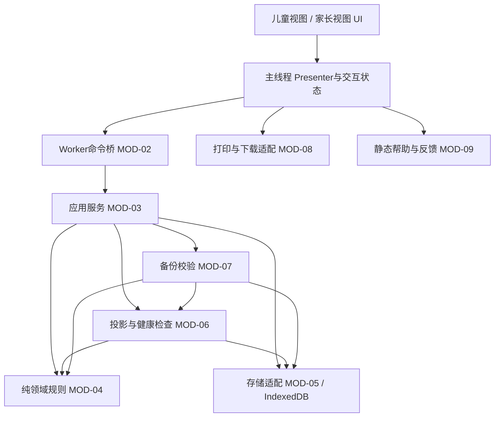
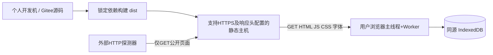
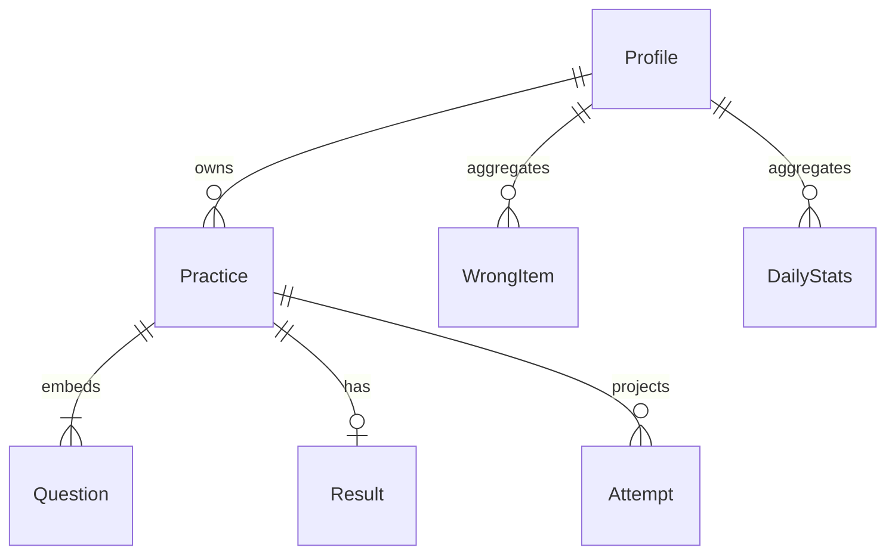
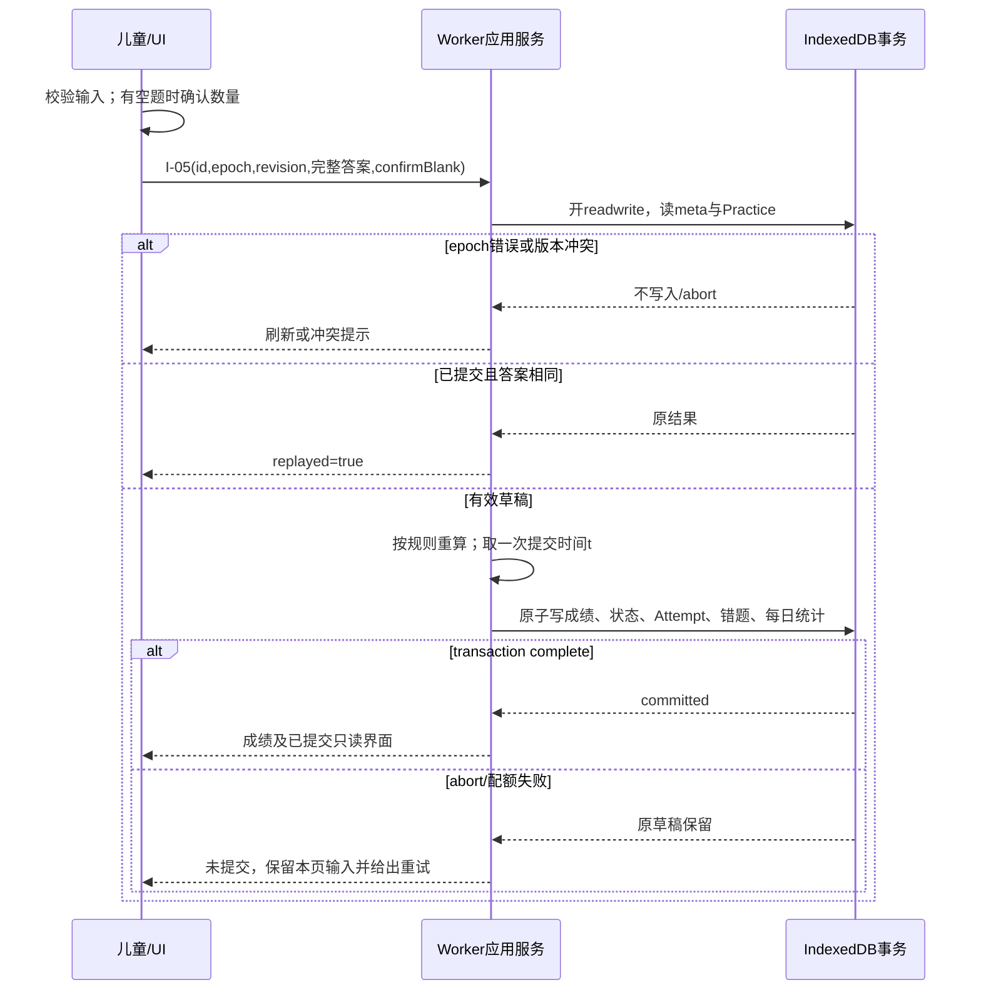

# 儿童学习口算练习系统——软件设计文档

版本：SDD v1.1  
日期：2026-10-12  
性质：实验2，架构设计与系统设计；个人项目；待实现设计基线  
项目仓库：https://gitee.com/foggycry/software-engineering  
需求基线：《儿童学习口算练习系统需求分析文档》v1.1。本文保留原需求编号，包含设计阶段的显式澄清与修正。文中性能数值是验收目标，不是已实现或已测试的成绩；仓库地址不等于已发布的应用地址。

## 1 文档约定、范围与需求基线

### 1.1 目标、用户与边界

系统帮助家长生成、批改口算练习，帮助一至三年级儿童在线答题、查看结果和复习错题。每日目标为30道已作答的普通练习题。三年可用指能够随年级调整指定题型，保留本地历史；不宣称覆盖三个年级的全部数学课程，也不宣称已证明能提高学习成绩。

采用响应式 Web 应用，公开 HTTPS 访问，无账号、无学习数据服务器。每个浏览器最多5个儿童档案，档案间数据隔离；换设备、换浏览器或换网站源不会自动同步。儿童和家长是两类操作视图，不是身份认证或访问控制角色。普通用户无需安装开发工具即可试用。

首版实现 FR01—FR13；FR09、FR10虽然是中优先级，也属于首版交付。FR14是低优先级后续候选，不计入首版完成条件。范围外包括拍照识别、语音识别、AI出题、账号登录、云同步、教师班级管理、排行榜、广告、付费、负数、小数、分数、余数和应用题。不得为这些功能预设后端服务。

### 1.2 基线识别与编号规则

冻结文件：`deliverables/儿童学习口算练习系统_需求分析文档_v1.1.md`。

该文件 UTF-8 原始字节 SHA-256：

```text
cebf2fbfc6dc9c84e910a9b2ae1b87f8beb8c3dcdfbc4a4fcf061b54bd7bc503
```

本文件附录C完整嵌入上述需求基线原文；同目录另有保持原始字节的[需求分析文档v1.1原件](儿童学习口算练习系统_需求分析文档_v1.1.md)。评审可直接对照附录C的FR/NFR/BR/UC条款与第11节矩阵，无需依赖未提交的外部文件。SHA-256针对原件字节，不针对正文摘要或Markdown渲染后的文本。

原始来源 S01—S03 为课程教案“2、儿童学习”（每天30题、一年级起使用三年、互联网直接试用），S04为用户任务及评分要求，S05为用户给出的仓库与提交约束。需求分析中的 A01—A06 是产品假设，不是访谈事实。本文不将这些假设改写成经过访谈验证的结论。

FR、NFR、BR、UC、AC、T 编号沿用需求基线；ARC=架构元素，MOD=模块，FLOW=流程，I=内部接口，EXT=外部接口，DAT=数据元素，UI=界面，ADR=设计决策，DT=设计验证用例，DCR=设计阶段需求变更。本文各节标题和这些编号是后续实现、测试和变更的定位依据。

### 1.3 需求编号对照与基线摘要

以下是原编号的摘要，非重新编号。逐条原文见附录C，设计落实见第11节；摘要不能替代原文约束。发现与原文差异时仅允许按1.5节的显式变更处理。

| 原编号 | 优先级 | 保留的需求内容 |
|---|---|---|
| FR01 | 高 | 建立、选择、改名、升年级、删除档案；最多5个；历史题单不随档案修改 |
| FR02 | 高 | 年级、合法题型、10/20/30题配置；默认30题；提示按已学内容选择 |
| FR03 | 高 | 生成并保存固定题单；单份不重复；刷新保持题目与顺序 |
| FR04 | 高 | 数字输入、空题、自动保存与真实保存提示；已提交只读 |
| FR05 | 高 | 空题确认、逐题批改、正确率和计数；提交幂等 |
| FR06 | 高 | 按档案和日期查历史；每日已答目标；区分普通练习与复习 |
| FR07 | 高 | 规范题目键归集错题，最近优先最多30题复习；正确复习清除待复习标记 |
| FR08 | 高 | 每档案至多一份普通草稿、一份复习草稿；恢复、中断和损坏处理 |
| FR09 | 中 | A4题单和独立答案页；打印不修改题单、计数与容量 |
| FR10 | 中 | UTF-8 JSON备份，schemaVersion=1；最多50MiB；完整校验后原子替换 |
| FR11 | 高 | 本地数据说明；最少信息；双重确认清除；反馈仅展示/复制维护者邮箱 |
| FR12 | 高 | 无登录公开HTTPS试用、README、帮助、反馈；演示后至少30天可用 |
| FR13 | 高 | 儿童答题视图、家长管理视图；短按钮、清晰状态、可操作错误提示 |
| FR14 | 低 | 后续外观主题候选；不影响算法、答案、统计与存储 |
| NFR01 | 高 | 题目、判分、统计错误数为0 |
| NFR02 | 高 | 5万题明细下生成/提交P95≤500ms、历史≤1s、输入显示≤100ms |
| NFR03 | 高 | 字号、触控区域、对比度、键盘、360—1440px及200%缩放要求 |
| NFR04 | 高 | 已保存可恢复、无重复提交计数、备份往返一致 |
| NFR05 | 高 | 业务数据外传请求为0；用户输入纯文本；HTTPS |
| NFR06 | 高 | 30天每5分钟探测，成功率≥99%；确认故障后24小时内恢复 |
| NFR07 | 中 | 指定网络冷加载P95≤3s；50并发HTTP成功率≥99%；四种浏览器兼容 |
| NFR08 | 中 | 依赖锁定、可重复构建、发布版本及需求—测试追溯 |

### 1.4 保留的业务规则

| 原编号 | 设计必须遵守的规则 |
|---|---|
| BR01 | 二元单步整数运算；减法结果非负；除法整除且除数非0；规则见下表 |
| BR02 | 普通练习题数10/20/30；k种题型各分配floor(N/k)，余数依次分给+、-、*、/中已选项，然后混排 |
| BR03 | 同题单按规范键去重：加法、乘法交换操作数视为同题；减法、除法保持顺序；不同题单允许重复 |
| BR04 | 全角数字转半角，首尾空白去除，1—4位数字转0—9999整数；空白为null；正确率以全部题数为分母，四舍五入一位小数 |
| BR05 | 当日进度只累加已提交普通练习中的非空答案数；复习、打印、重复提交不增加；≥30达标，允许超过30 |
| BR06 | 使用设备时钟和Asia/Shanghai日期；按提交日期记账；每60秒及窗口恢复焦点刷新“今天”；历史日期固定 |
| BR07 | 持久化状态仅draft/submitted；成绩、状态、提交时间及派生统计原子提交；成功后只读，失败仍为原草稿 |

| 规则版本1 | 加法 | 减法 | 乘法 | 除法 |
|---|---|---|---|---|
| G1 | a、b及a+b均在0—20 | 0≤b≤a≤20 | 不提供 | 不提供 |
| G2 | a、b及a+b均在0—100 | 0≤b≤a≤100 | a、b各1—9 | 除数和商各1—9，被除数为乘积 |
| G3 | a、b及a+b均在0—1000 | 0≤b≤a≤1000 | a为10—99，b为1—9 | 除数2—9，商1—99，被除数≤1000 |

G1默认加减；G2、G3默认四则；家长可取消未学题型但不能全取消。所有配置页展示“请按已学内容选择题型；年级预设不代表课程全覆盖”。复习不按新年级重新生成，保留原题sourceGrade和ruleVersion。

### 1.5 设计阶段变更与澄清登记

本文作为实验2设计基线纳入以下条目，不覆盖修改原需求文件。它们是本次设计提出的明确决定，不虚构额外人工批准或已完成实现。

| 编号/性质 | 原文问题 | 本文决定及理由 | 影响范围/兼容性 |
|---|---|---|---|
| DCR01 细化 | BR06“成功提交时刻”未给数据库取时点；跨午夜事务可能开始和完成分属两天 | 在提交事务完成版本检查、即将写入提交记录时取一次设备时间t，保存UTC时间和上海日期。只有事务complete才认可此次提交；不使用complete回调的第二次读钟结果 | BR06、FR05、FR06、T04；不改变时区和“提交归属日”原则，但明确临界毫秒口径；DT04 |
| DCR02 补充 | FR07没明确普通练习答对是否消除已有待复习标记 | 仅复习答对清除needsReview；普通练习答对不清除；任何练习答错/空答使其为true并增加累计错误次数 | FR07、错题重放和导入校验、T05；不调整原复习规则；DT05 |
| DCR03 细化 | NFR07从导航到打开题单含用户操作，人工思考时间不确定 | 用自动脚本在控件可用后立即完成首次说明、创建测试档案、用默认配置生成题单；计时包含这些操作与持久化，不含人工等待 | NFR07、T09；3s阈值和浏览器矩阵不变；DT09 |
| DCR04 补充数据契约 | 基线Practice未列result的归属、草稿null值、规范题目键语法和备份字段白名单 | 明确result属于Practice；详见5.2—5.4；增加仅数据库内部的版本与索引字段，不导出这些字段 | FR03—FR10、NFR04；初版尚无已投产备份，不声称兼容任意历史JSON；schemaVersion仍为1，未来改变交换字段须升版本 |

其余需求编号、优先级、容量、题型范围、功能边界保持不变。新增分页上限、预览令牌、事务串行化等是技术限制或内部机制，不减少业务可达数据。后续改动登记DCR/CR编号、原因、原值/新值、受影响需求/接口/实体/测试及迁移方案；不得复用已删除编号。

## 2 架构设计

### 2.1 ARC-01 逻辑架构与依赖

选择单个浏览器应用，分为视图层、应用服务层、领域规则层、基础设施适配层。TypeScript提供静态类型，原生DOM组件承担视图，Vite只作为开发与构建工具。首版不引入全局状态框架、服务器数据库、微服务、消息队列和在线AI服务。



图中文字关系也是规范：UI只能通过Presenter调用命令桥；应用服务编排规则和存储；领域函数只依赖参数，不访问DOM、网络、设备时间和数据库。时间、随机源、UUID源由适配层注入，便于边界测试。MOD-06依赖领域规则与存储适配，负责投影重建、读取校验及隔离事务；MOD-07经MOD-06执行备份重放，经MOD-05读取或原子替换存储，不能反向依赖UI。备份校验复用同一业务规则，但测试答案使用独立算法，避免用被测函数自证正确。存储适配不调用视图。打印通过只读DTO获得题单，不持有写接口。

### 2.2 ARC-02 运行视图

一个标签页有一个主线程和一个Dedicated Worker。主线程处理按键、焦点、视图渲染、文件选择及打印；Worker承担生成、校验、IndexedDB事务、导入重放等工作，避免大文件解析阻塞输入。Worker初始化成功并打开数据库后才显示持久化功能可用。

每个标签页的Worker可连接同一数据库；所有写事务包含meta存储，利用数据库事务互斥完成版本检查与写入。BroadcastChannel仅通知其他标签页刷新，消息丢失不能破坏一致性：每次写入仍校验epoch和revision，每次窗口获得焦点仍重新读取。一个标签页内同一题单写命令排队，未发出的自动保存可合并为最新答案快照。

主线程只缓存当前页面所需DTO。跨标签页广播只含epoch、changeSeq、受影响ID，不广播答案副本。Worker退出后主线程进入“连接中断”；重新创建Worker并读取数据库后才能判断上次提交是否成功，不凭超时自行断定失败。

### 2.3 ARC-03 部署与网络视图



构建产物包括index.html、带内容哈希的JS/CSS、Worker脚本和静态帮助资源；不包含用户数据、密钥或运行时服务器程序。采用hash路由（例如`/#/practice/<id>`），静态主机无需实现业务路由重写。正式URL、维护邮箱和发布版本属于发布配置，当前尚未指定，发布检查不允许占位符。

首次加载需要网络。界面就绪前完成核心代码和Worker加载；已打开页面断网后可继续本地核心操作。首版不配置Service Worker，不承诺离线首次打开或离线刷新成功。HTML使用可重新验证的缓存策略，哈希资源长期缓存；部署保留上一版哈希资源供已打开页面使用。公网50并发影响静态资源分发，各用户本地数据库互不共享，不对应50个数据库并发写者。

环境依赖：浏览器须支持IndexedDB、Worker、文件选择/Blob下载、打印、HTTPS安全上下文UUID能力；BroadcastChannel缺失时用焦点刷新替代通知。数据库不可用走临时模式；Worker不可用时展示不兼容提示及帮助，不悄悄切换到未经测试的主线程大文件实现。外部网络不可用与本地存储不可用是不同状态。

## 3 模块设计

| 元素 | 边界、内部结构与职责 | 对外依赖/对应依据 |
|---|---|---|
| MOD-01 视图与Presenter | ProfileView、ConfigView、PracticeView、ResultView、HistoryView、ParentView；管理焦点、输入原始串、保存状态、弹窗；不算成绩 | MOD-02、MOD-08、MOD-09；FR01—FR13、NFR03 |
| MOD-02 命令桥 | requestId关联Promise；同题单队列；structured clone消息；超时后状态查询；不直接写库 | Worker应用服务；NFR02、NFR04 |
| MOD-03 应用服务 | ProfileService、PracticeService、ReviewService、HistoryService；校验命令、组织事务、返回DTO | MOD-04/05/06/07；FR01—FR08 |
| MOD-04 领域规则 | ruleRegistry、poolRanker、answerNormalizer、grader、questionKey、reviewReducer、ShanghaiDate；纯函数 | 注入clock/random/uuid；BR01—BR07、NFR01 |
| MOD-05 存储适配 | schema/index定义、Repository、UnitOfWork、epoch/revision检查、数据库升级；事务边界唯一入口 | IndexedDB；FR04/05/08/10/11、NFR04 |
| MOD-06 投影与健康检查 | attempts、wrongItems、dailyStats重建；读取校验；损坏隔离标记；容量核对 | MOD-04/05；FR06—FR08 |
| MOD-07 备份 | ExportSnapshot、ImportValidator、ImportPreview、AtomicReplace；只处理声明的JSON白名单 | MOD-04/05/06；FR10、NFR05 |
| MOD-08 浏览器输出 | printRenderer、downloadAdapter、clipboardAdapter；A4打印与JSON下载；不生成新题单 | 浏览器API；FR09—FR11 |
| MOD-09 帮助与发布 | 本地数据声明、版本信息、反馈地址、静态标识、构建/部署说明 | 静态配置；FR11/12、NFR06—08 |

建议目录：`src/ui/`、`src/app/`、`src/domain/`、`src/infra/idb/`、`src/backup/`、`src/worker/`、`src/print/`、`tests/`、`docs/`。`domain`禁止导入`ui`和`infra`，`ui`禁止直接引用IndexedDB；以静态依赖检查验证。规则注册表按ruleVersion保留旧版本解释器；新增年级规则不改写历史题。

### 3.1 MOD-04 出题算法与可行性

普通练习先分配题型数量，再在每种有限题库中无放回抽样，最后洗牌。采用可排名题库，不在页面启动时构造百万级对象，也不靠“随机生成直到不重复”的不确定循环。

加法规范候选为`0≤a≤b, a+b≤M`，固定a的一行有`M−2a+1`个候选；行前缀和定位rank。减法固定a时b从0至a，一行a+1个。G2乘法仅枚举`1≤a≤b≤9`；G3乘法以两位数为a、一位数为b。除法按“除数、商”排名，再计算被除数。抽到规范加法/G2乘法后可随机交换显示操作数；键仍规范化，G3乘法不交换以满足题型范围。

| 年级 | 加法候选数 | 减法候选数 | 乘法候选数 | 除法候选数 |
|---|---:|---:|---:|---:|
| G1 | 121 | 231 | — | — |
| G2 | 2601 | 5151 | 45 | 81 |
| G3 | 251001 | 501501 | 810 | 792 |

使用稀疏Fisher–Yates映射从`[0,poolSize)`抽取所需rank，辅助空间O(N)，N≤30；rank解码用行前缀二分。均匀随机整数用32位随机值和拒绝采样消除取模偏差，随机源故障返回E_RANDOM，不降级为全零种子。测试注入固定随机序列以重现失败。每个题型池均大于其最大30题配额；仍保留池不足E_POOL，供规则变更时防护。

判分只做整数运算。若C为正确数、N为题数，正确率的十分位整数为`floor((2000*C+N)/(2*N))`，显示时除10并保留一位；例如18/30→60.0%。该表达式实现非负数四舍五入，不使用字符串浮点比较。

## 4 接口设计

### 4.1 公共协议、类型与错误

I系列是应用内部命令，不是HTTP API。主线程与Worker交换JSON兼容对象；文件二进制单独用ArrayBuffer传输。日期序列化为字符串，禁止Date对象、undefined、NaN、Infinity、函数或DOM节点。

```typescript
type UUID = string; // 小写标准UUID v4字符串
type Grade = 1 | 2 | 3;
type Op = "+" | "-" | "*" | "/";
type Answer = number | null; // 整数0..9999或null
type WriteGuard = { epoch: UUID };
type PracticeGuard = WriteGuard & { expectedRevision: number };
type Response<T> =
  | { requestId: UUID; ok: true; data: T; epoch: UUID; changeSeq: number }
  | { requestId: UUID; ok: false; error: {
      code: string; message: string; field?: string;
      retryable: boolean; recovery: string;
      errorCount?: number;
      details?: { code: string; field: string; message: string }[]
    } };
// 调用信封：{ requestId, method, params }；requestId用于关联，不替代业务幂等键。
```

所有接口都校验输入结构和未知字段；业务错误通过Response返回，不把异常栈展示给儿童。`field`使用字段路径（如`answers[2].value`），不回传整份用户数据。批量校验错误可附errorCount和最多20条details；未提供时省略这些可选字段。服务器HTTP错误与下列本地错误码分开。

| 错误码 | 含义 | 重试/用户动作 |
|---|---|---|
| E_VALIDATION | 类型、范围、未知字段或非法答案 | 否；定位字段修改 |
| E_NOT_FOUND | 档案或题单不存在 | 否；回到列表刷新 |
| E_LIMIT / E_POOL | 5档案、50000题上限或候选不足 | 否；备份后清理或修改配置 |
| E_CONFLICT | revision或changeSeq已变 | 否；显示外部变更，重新读取后由用户选择 |
| E_EPOCH | 数据已整体导入/清除 | 否；丢弃旧缓存，重新选档；不得回写旧答案 |
| E_READ_ONLY | 已提交题单试图修改 | 否；展示已提交结果 |
| E_BLANK_CONFIRM | 有空题但未确认 | 否；返回空题数，确认后重新提交 |
| E_STORAGE / E_QUOTA | 存储禁用、故障或配额不足 | 有条件；恢复存储/清理后重试，保留输入 |
| E_CORRUPT | 数据结构或关系校验失败 | 否；隔离、导出原始记录、明确删除或恢复备份 |
| E_VERSION | 未支持的备份/题目/数据库版本 | 否；使用匹配版本，绝不猜测迁移 |
| E_PREVIEW_EXPIRED | 导入预览超过5分钟或Worker已重启 | 否；重新预览 |
| E_RANDOM | 随机源不可用 | 是；重试或检查浏览器 |
| E_TIMEOUT | 调用超过等待阈值，结果可能未送达 | 不盲目重放；先查状态，再按幂等规则重试 |

普通命令UI在5秒未响应时提供“查询状态”；导入/全量导出在30秒时提示仍未完成并允许查询或请求取消。等待阈值不是性能合格阈值。取消只在提交前终止准备或对仍活动的事务调用abort；已提交不能撤销。返回E_TIMEOUT不意味着数据未写入。

### 4.2 内部接口清单

接口DTO引用第5节的明确字段；除特别声明外，不返回原始数据库内部字段。只读查询也返回epoch/changeSeq，后续写入必须使用最新读取的版本。

| 编号/接口 | 输入params | 输出data | 前置条件、限制和主要错误 |
|---|---|---|---|
| I-01 `profile.list` / `profile.create` | list:{}；create:{epoch,nickname,grade} | list:{profiles:ProfileView[]}；create:ProfileView | 最多5；nickname规范见DAT-01；E_LIMIT/E_VALIDATION |
| I-02 `profile.update` | {epoch,id,expectedProfileRevision,nickname,grade} | ProfileView | 只改档案，revision+1；历史不变；E_CONFLICT |
| I-03 `practice.create` | {epoch,profileId,expectedProfileRevision,grade,operators:Op[],count:10或20或30,replaceDraftId:UUID或null,replaceDraftRevision:整数或null} | PracticeView | operators无重复非空且合法；grade为本次选择；有草稿必须指明已确认替换的ID和版本；E_CONFLICT/E_POOL/E_LIMIT |
| I-04 `practice.save` | {epoch,id,expectedRevision,answers:{questionId:UUID,value:Answer}[]} | {id,revision,updatedAt} | 完整答案快照，恰好覆盖本题单全部questionId且不重复；draft；同页串行；E_READ_ONLY/E_CONFLICT |
| I-05 `practice.submit` | 同I-04，另含confirmBlank:boolean | {practice:PracticeView,result:Result,replayed:boolean} | 含最新完整答案，因此不依赖最后自动保存完成；空题未确认返回E_BLANK_CONFIRM；幂等见FLOW-03 |
| I-06 `practice.get` / `practice.resume` | get:{id}；resume:{profileId} | get:PracticeView；resume:{normal:PracticeView或null,review:PracticeView或null,recommendedId:UUID或null} | 推荐updatedAt最新者，相等按id升序；损坏项不作为有效草稿，响应另含warnings |
| I-07 `history.query` / `progress.today` | query:{profileId,from,to,cursor:string或null,limit:整数}；today:{profileId} | query:{items:PracticeSummary[],nextCursor:string或null,excludedCount:整数}；today:{date,answeredCount,target:30,achieved:boolean,excludedCount} | 上海日期闭区间，from≤to；默认最近7天；limit1—100，默认20；游标绑定参数与changeSeq，变更后E_CONFLICT；仅submitted |
| I-08 `review.list` / `review.create` | list:{profileId,cursor,limit}；create:{epoch,profileId,expectedProfileRevision,replaceDraftId,replaceDraftRevision} | list:{items:WrongItem[],nextCursor}；create:PracticeView | 查询limit1—100；create重新在事务内选取needsReview最近30题；零题返回空状态而非空题单 |
| I-09 `backup.export` | {} | {fileName,mime:"application/json;charset=utf-8",bytes:ArrayBuffer} | 同一只读事务快照；有损坏原始数据时拒绝普通备份并指向诊断导出；不得静默遗漏 |
| I-10 `backup.preview` | {bytes:ArrayBuffer} | {token:UUID,expiresAt,profileCount,practiceCount,questionCount,basisChangeSeq} | ≤50MiB，最多5档案及50000题，完整校验；token绑定内存中已验证内容和epoch/changeSeq；E_VERSION/E_CORRUPT |
| I-11 `backup.replace` | {epoch,token,confirmReplace:true} | {newEpoch,profileCount,questionCount} | token限本Worker一次使用且5分钟有效；版本未变化；一次事务全量替换；E_CONFLICT/E_QUOTA |
| I-12 `data.delete` | {epoch,target:"profile"或"all"或"corruptPractice",id:UUID或null,basisChangeSeq,confirm:true} | {newEpoch,deletedProfiles,deletedPractices,questionCount} | UI先选删除再输入“删除”完成双重确认；all的id=null；事务后更换epoch；E_CONFLICT |
| I-13 `print.read` | {id,variant:"questions"或"answers"} | {profileNickname,gradeSnapshot,practiceId,questions:Question[],variant} | 只读；答案页独立选择；不新建/保存草稿；E_CORRUPT |
| I-14 `health.inspect` / `health.exportRaw` | inspect:{}；exportRaw:{practiceId} | inspect:{mode,issues,epoch,changeSeq}；exportRaw:{fileName,bytes} | raw输出是诊断JSON封装，不是可导入备份；包含原始记录和原因，标明隐私提示 |

`ProfileView=Profile+profileRevision`，profileRevision为从0开始的非负整数；`PracticeView=Practice+saveState`，从数据库读出的saveState固定为`saved`，界面收到响应后仍须根据本地输入序号判断是否有尚未保存的新内容。saveState仅为响应视图值，不进入备份。`PracticeSummary`字段为id、profileId、gradeSnapshot、kind、submittedAt、submittedDate、questionCount、result。I-06与I-07的成功响应data另可含warnings，类型为`{id:UUID,code:string}[]`，默认空数组，不含答案。

I-14的mode枚举为`persistent`（读写可用）、`readOnly`（读取可用但停止写入）、`temporary`（持久化不可用）。issues为`{practiceId:UUID或null,code:string,recovery:string}[]`，null表示全库问题；临时模式没有有效epoch/changeSeq，I-14以错误Response返回E_STORAGE并附details，UI据此进入temporary，不伪造持久化成功响应。I-14成功响应只可能为persistent/readOnly，并返回真实epoch/changeSeq。原始诊断下载是UTF-8 JSON，顶层固定`diagnosticVersion:1,exportedAt,practiceId,reasonCodes,raw`；raw允许原始可序列化记录，不经过普通备份白名单，不可用于I-10导入。不能完整序列化的损坏值返回E_CORRUPT，不能声称已成功导出。I-14 `health.exportRaw`的fileName固定为`oral-practice-diagnostic-<practiceId>-YYYYMMDD-HHmmss.json`，其中practiceId使用完整小写UUID，时间取生成诊断时的上海时间；例如`oral-practice-diagnostic-10ea882b-dcd5-4333-8171-2d6a46b4db2e-20261012-100000.json`。不得将昵称等用户文本拼入文件名。

cursor是应用生成的分页位置令牌，包含查询参数、changeSeq和最后一项排序键；解码后逐字段校验，不信任客户端字符串。I-07顺序见FLOW-04，I-08仅列needsReview=true的错题并沿用DAT-02排序；其cursor同样绑定profileId、changeSeq和最后排序键。任何分页读取检测到changeSeq变化均返回E_CONFLICT并要求从第一页重新查询，防止翻页重复或遗漏。

### 4.3 输入输出示例与调用规则

```json
{
  "requestId": "d762a9ef-9a21-4bca-934b-21884a0fe126",
  "method": "practice.create",
  "params": {
    "epoch": "03c7caef-f233-4767-a75b-4a882c9574c2",
    "profileId": "10ea882b-dcd5-4333-8171-2d6a46b4db2e",
    "expectedProfileRevision": 0,
    "grade": 1,
    "operators": ["+", "-"],
    "count": 30,
    "replaceDraftId": null,
    "replaceDraftRevision": null
  }
}
```

```json
{
  "requestId": "d762a9ef-9a21-4bca-934b-21884a0fe126",
  "ok": false,
  "error": {
    "code": "E_CONFLICT",
    "message": "已有练习草稿，请先选择继续或替换。",
    "retryable": false,
    "recovery": "重新读取草稿后选择继续；确认替换时提供草稿编号和版本。"
  }
}
```

同一题单同一标签页最多1个在途写命令；保存按200ms防抖，连续输入时最迟800ms发起一次最新快照保存，满足“变更后1秒内尝试保存”。E1正常存储下验收在输入停止1秒后刷新可恢复；页面未显示已保存前离开仍可能丢失未提交输入。提交命令排在已发出的保存之后，合并尚未发出的保存，发送当前答案和最新revision。重复按提交被UI暂时禁用，事务层仍必须幂等。

### 4.4 外部接口与第三方边界

| 编号 | 名称与格式 | 错误、限制及处理 |
|---|---|---|
| EXT-01 静态HTTPS | 浏览器GET `/`、哈希资源路径；响应HTML/JS/CSS，UTF-8；不设置业务POST接口 | HTTP非200、证书错误、资源丢失→加载失败/重试；不上传昵称、答案、成绩；同源策略下域名/协议/端口变化不会自动迁移本地库 |
| EXT-02 IndexedDB | DB `children-arithmetic`，初始数据库版本1；objectStore、key/index与事务见第5节 | blocked/versionchange/abort/QuotaExceededError；请求success不等于事务完成，持久化成功以complete为界；不保证用户清理后或物理磁盘故障恢复 [R1][R2] |
| EXT-03 文件选择/下载 | 用户选择本地JSON，读取ArrayBuffer；导出Blob下载，文件名`oral-practice-backup-YYYYMMDD-HHmmss.json`（上海时间） | 取消选文件不写库；大小限制先检查；浏览器下载受限时提供重试；仅表示已交给浏览器下载，不宣称文件已落盘 |
| EXT-04 浏览器打印 | `window.print()`打开打印对话框，CSS `@page { size:A4; margin:15mm }` | 不检测实际纸张是否打印成功；关闭/取消/另存PDF均不记学习进度；浏览器可能调整页边距 [R3] |
| EXT-05 反馈地址 | 发布配置`maintainerEmail`显示为纯文本；用户点击复制时调用剪贴板API | 权限拒绝时提供可选择文本；不自动发送邮件、不创建附带数据的mailto链接，无第三方反馈API |
| EXT-06 可用性探测 | 外部工具每5分钟GET公开入口；HTTP200且含`data-app="oral-practice"`为成功 | 失败/超时均计失败，监测工具不读取本地学习数据；超时10秒；缺测记为失败并单独标记 |

当前没有支付、身份、OCR、AI、云数据库等第三方接口。接口名与参数均由本系统定义；不得把尚未开通的托管平台能力写作已存在依赖。

## 5 数据设计

### 5.1 DAT-00 实体关系与权威数据



Profile、Practice及其内嵌Question/Result是权威数据。Attempt、WrongItem、DailyStats是可重建投影；投影不作为原始作答的替代。问题ID在所有有效题单内全局唯一；同一道数学题在不同题单有不同问题ID，但规范questionKey相同。一个题单只属于一个档案，禁止悬空外键。数据库不提供应用层外键，必须在同一事务内检查。

### 5.2 DAT-01 档案、题单与答案字段

所有交换对象仅允许表中字段，字段均必填，允许空值处明确写null。整数为安全整数，不接受字符串代替数字；UUID统一小写。时间输出固定UTC格式`YYYY-MM-DDTHH:mm:ss.SSSZ`；导入允许合法ISO8601带时区，解析后规范化为该格式。`submittedDate`固定`YYYY-MM-DD`并与提交时刻换算的上海日期一致。设备时钟可回拨，因此不强制updatedAt≥createdAt或submittedAt≥createdAt，revision承担版本排序。

| 实体/字段 | 类型与约束 |
|---|---|
| Profile.id | UUID主键 |
| Profile.nickname | trim后1—20个Unicode码点，拒绝控制字符；允许不同档案重名，以ID区分；不索要真名 |
| Profile.grade | 1/2/3 |
| Profile.createdAt | ISO8601时间 |
| Practice.id / profileId | UUID主键/有效Profile外键 |
| Practice.gradeSnapshot | 生成时选择的年级1/2/3，不因档案升年级更改 |
| Practice.ruleVersion | 1；旧版本解释器缺失则拒绝导入/新建相关练习，不猜测算法 |
| Practice.kind / status | `normal`或`review`；`draft`或`submitted` |
| Practice.revision | 非负整数；初始0，每次成功保存或提交加1；只读查询不增加 |
| Practice.createdAt / updatedAt | ISO8601时间；保存失败不更新 |
| Practice.submittedAt / submittedDate | draft均为null；submitted均非null，按DCR01取值 |
| Practice.questions | normal长度10/20/30；review长度1—30；数组顺序固定，ordinal连续1..N |
| Practice.result | draft为null；submitted为Result；即使draft已有答案也不得伪造成正式成绩 |
| Question.id / ordinal | UUID；本题单题号1..N |
| Question.sourceGrade / ruleVersion | 原始题型所属年级和规则版本；normal与Practice一致，review允许混合年级但首版版本均为1 |
| Question.a / b / op | 非负整数操作数；op为+、-、*、/；满足sourceGrade规则 |
| Question.expected | 按规则独立重算得到的正确整数，不信任导入值 |
| Question.answer | null或0—9999整数；未经规范化的输入原始串只存在UI内存，不进入库 |
| Result.correctCount / wrongCount / blankCount | 非负整数，和等于N；wrong不含空题 |
| Result.answeredCount | correctCount+wrongCount |
| Result.accuracy | 0—100数值，最多一位小数，等于BR04公式；界面显示60.0%，JSON可为60 |

导入成绩按JSON数值比较，不按源文本的字面写法比较。例如对18/30的题单，`{"accuracy":60}`与`{"accuracy":60.0}`解析后的数值同为60，均与重算结果相等；这两个片段仅说明Result字段，不是完整备份。界面统一格式化为`60.0%`，导出可序列化为`60`，往返比较仍判等价。`{"accuracy":"60.0"}`因类型为字符串而拒绝；`{"accuracy":60.04}`不得先四舍五入再接受，应因不等于重算的一位小数结果而拒绝。

普通题单已选题型从questions的op集合确定（N≥10且k≤4，每个所选题型至少出现一次），生成验收和导入均按BR02核对频数，因此无需额外存储一个可能与题目不一致的operators副本。昵称打印时读取当前档案昵称，不声称记录历史昵称；历史年级来自gradeSnapshot。

### 5.3 DAT-02 错题与派生数据

`questionKey`语法为`op:a:b`，整数十进制无前导零；加/乘先将操作数升序，减/除保持原序。例如`+:3:5`、`-:20:7`、`/:81:9`。键不含grade或ruleVersion，数学表达式相同即归集；展示表达式保留最近错误事件的原操作数顺序与来源年级。

| 实体 | 字段/约束与生成方式 |
|---|---|
| WrongItem（交换字段） | profileId、questionKey、a、op、b、expected、wrongCount、lastWrongAt、needsReview；联合键[profileId,questionKey]；wrongCount≥1，lastWrongAt为最近错误事件时间，needsReview为boolean |
| WrongItem（库内附加） | sourceGrade、ruleVersion、representativePracticeId、representativeQuestionId，定位最近错误题；reviewSortTime是lastWrongAt毫秒数的相反数用于升序取最近；pendingKey为1或0，避免使用boolean作为IndexedDB索引键 |
| Attempt（库内） | [practiceId,questionId]为主键；profileId、questionKey、submittedAt、practiceId、ordinal、kind、answer、expected、sourceGrade、ruleVersion、a、b、op；每个已提交问题一条，草稿无Attempt |
| DailyStats（库内） | 联合键[profileId,date]；answeredCount≥0、normalPracticeCount≥0；仅来自有效submitted normal题单，不含复习 |

重放顺序固定为`submittedAt升序→practiceId字典升序→ordinal升序`。同题单无重复规范键，ordinal只是最终确定性约定。错误/空题事件使wrongCount+1、needsReview=true，并更新最近错误表达式；复习答对使needsReview=false；普通答对不改变WrongItem；从未错过的题不创建WrongItem。wrongCount是累计错误次数，答对不减。设备回拨导致新提交时间落在旧事件之前时，按同一顺序重新归约受影响键，保证线上更新与导入重建一致；界面提示设备时钟可能不准，不宣称有可信服务器时间。

复习候选：仅needsReview=true，按lastWrongAt降序、questionKey升序取前30；保持该顺序展示，生成新的Question.id，沿用代表错误题的a/b/op/expected/sourceGrade/ruleVersion。原题单不删除。Review题单的gradeSnapshot是当前档案年级，仅作当次背景，不用于限制各题年级。

### 5.4 DAT-03 备份格式

顶层白名单严格为`schemaVersion,exportedAt,profiles,practices,wrongItems`；schemaVersion固定1，exportedAt为合法时间，其余为上述交换实体数组。每层未知字段均拒绝，数据库内部字段不得混入。空库合法完整样例：

```json
{
  "schemaVersion": 1,
  "exportedAt": "2026-10-12T02:00:00.000Z",
  "profiles": [],
  "practices": [],
  "wrongItems": []
}
```

校验顺序：文件字节数≤52,428,800 → UTF-8/JSON语法与嵌套结构 → 白名单/类型/数量 → UUID唯一与外键 → 所有题型与规范键唯一 → normal配额 → 草稿槽唯一 → submitted的时间/成绩 → 从submitted重建全部WrongItem并逐字段比较输入值。备份中的WrongItem若与重建不符，拒绝整份，不悄悄修正。题单中任何expected或Result与重算不符也拒绝。导入草稿不参加错题重放。

导出是单个只读事务中的一致快照；投影剥离内部字段后排序为固定键序，便于往返比对。导出时间、数组排序、UTC时间规范化和库内版本不参与业务等价比较；档案、每题答案、题单状态、成绩、每日进度与错题必须等价。超过50MiB的非本系统文件直接拒绝；本系统50000题上限的数据需在DT07验证导出尺寸不超过导入上限，未满足则不能发布“可备份恢复”的功能。

### 5.5 DAT-04 存储结构、索引与容量

| Object store | 主键 | 索引及用途 |
|---|---|---|
| profiles | id | 无需额外索引，最多5项；附加profileRevision |
| practices | id | byProfile(profileId)；byDate[profileId,submittedDate,submittedAt,id]；byDraftSlot(draftSlot)唯一索引 |
| attempts | [practiceId,questionId] | byPractice(practiceId)；byQuestion[profileId,questionKey,submittedAt,practiceId,ordinal] |
| wrongItems | [profileId,questionKey] | byPending[profileId,pendingKey,reviewSortTime,questionKey] |
| dailyStats | [profileId,date] | 主键范围查询即可 |
| meta | key（固定`state`） | value含epoch、changeSeq、questionCount、dbSchemaVersion |
| quarantine | practiceId | reasonCodes、detectedAt、reservedQuestionCount；原始坏记录保留在practices，标记隔离，不自动物理删除 |

`draftSlot=profileId+":"+kind`仅存在于draft的库内记录，submitted删除该属性；唯一索引保证每档案每种草稿至多一份。可选属性不属于交换对象。byDate对submittedDate=null的草稿不建立有效复合索引项；仍需在读路径检查status，不能只依赖索引隐含过滤。

questionCount只计practices内所有普通/复习、草稿/提交的questions条数。上限50000，投影不重复计入。生成替换草稿采用`新总量=旧总量−被替换题数+新题数`，同事务检查≤50000。保存、提交、打印均不增加题数。三年每天30题为32850题（按1095天），余17150题；这是容量预算，不是承诺无限历史。导入为全量替换，不与旧容量相加。

损坏隔离不释放容量，以保存时的questionCount及该记录已知题数预留；用户确认删除坏记录才释放。若meta也损坏或无法可信确定坏记录题数，则停用新增写入，提供原始诊断导出、恢复备份/清空，不自行猜出一个较小容量继续写。普通查询排除坏记录并明确excludedCount，不能把缺失成绩显示为0分。

### 5.6 DAT-05 事务、一致性与迁移

所有写入经UnitOfWork；写事务均包含meta，并在同一事务中读epoch、相关revision/外键、容量后写入。事务内只串联IndexedDB请求回调，不等待网络、计时器、文件读取或Worker消息，防止事务变为inactive。以事务complete返回成功，abort保留旧数据；单个put的success不能驱动“已保存” [R1][R2]。

| 操作 | 单次readwrite事务包含的存储及原子效果 |
|---|---|
| 建档/改名/升年级 | meta、profiles；检查数量/版本；更新档案和changeSeq |
| 新建/替换普通草稿 | meta、profiles、practices；检查档案版本、旧草稿版本、容量；删除旧草稿并插入新草稿一次完成 |
| 生成复习 | meta、profiles、practices、wrongItems、attempts；事务内读取当前候选及代表题，避免预览后错题已变化 |
| 自动保存 | meta、practices；检查epoch、draft和revision；替换完整答案快照，revision+1 |
| 提交 | meta、practices、attempts、wrongItems、dailyStats；写答案和成绩、清除draftSlot、写Attempt、更新当日统计并归约受影响错题；任何失败全部回滚 |
| 导入/全量清理 | 全部存储；校验预览版本后clear/put，重建投影、容量，创建新epoch；不使用先删库再建库方式 |
| 删除档案 | 全部相关存储；删除该档案及关联题单/投影/隔离标记，更新容量并换epoch，其他档案保持 |
| 删除坏题单/标记隔离 | meta、practices、quarantine及相关投影；按有效题单重建受影响档案投影；失败不删除原数据 |

所有成功写操作changeSeq+1。epoch是数据库内容代际UUID，整体导入或任何删除后更新，使其他标签页旧命令失效。Practice.revision解决同题单丢失更新，profileRevision解决生成期间升年级/改档案的竞争；不能只在UI按钮上加锁。导入保留备份中的Practice.revision，profiles的库内profileRevision重新从0开始，meta.changeSeq在旧值上加1并换新epoch；备份不包含可覆盖meta的字段。唯一draftSlot竞争产生的ConstraintError统一映射E_CONFLICT；任何相关事务因此中止，不能删除原草稿后留下空槽。

提交具有业务幂等键practiceId：先查epoch，再查题单。若已submitted且传入完整答案等于已存答案，直接返回原结果、replayed=true，不改时间/revision/changeSeq/统计，允许请求携带旧expectedRevision；若答案不同返回E_READ_ONLY。若仍draft才校验expectedRevision。返回丢失后以practice.get确定状态，避免重复计数。

初始数据库版本1与交换schemaVersion=1是两个不同版本号。后续升级通过onupgradeneeded事务迁移，其他连接收到versionchange应关闭并提示刷新；blocked提示关闭旧标签页。升级失败不清空旧库。不支持新版本的旧应用只读拒绝/提示升级，不能降低版本覆盖数据。发布回退仅在旧前端兼容当前库时执行，否则采用修复版本，不能强行回滚数据库。

## 6 关键流程与状态设计

### 6.1 FLOW-01 首次使用、建档与生成

1. UI-01展示本地保存边界，用户确认后调用I-14检查存储。正常则I-01创建/选择档案；不可用进入FLOW-07临时模式。
2. UI-02默认30题，显示年级题型和学习提示。客户端先做字段校验，Worker再次校验。
3. I-06发现同类型草稿时，界面提供继续或替换；取消不写库。替换必须取得旧ID和revision并显式确认。
4. I-03在Worker内生成候选、Question.id及固定顺序；生成失败不落部分记录。开启DAT-05事务重新检查epoch、档案版本、草稿槽和容量，写入完整草稿。
5. complete后返回UI-03开始答题。容量不足、版本冲突或配额故障时保留配置与旧草稿，明确对应恢复动作。

### 6.2 FLOW-02 输入、保存与恢复

输入经全角转半角、trim后判定。仅数字且长度≤4可转整数；`-1`、`1.5`、`1e2`、`12a`、五位数均拒绝；`0009`为9；空串为null。非法串留在界面供修改并标红，不覆盖已保存的合法答案，禁止提交。

视图保存子状态为clean→dirty→saving→saved，失败为unsaved，外部版本变化为conflict；这些不增加数据库status种类。打字立即渲染，MOD-02合并快照调用I-04。保存期间有新输入，旧响应只确认对应输入序号，不能把更新后的未保存答案标成已保存。离开题单时主动flush并等待结果；关闭浏览器前的最后异步保存不保证完成，应一直展示当前保存状态。

存储模式与上述保存子状态分开管理：`temporary → checking → persistent`的恢复路径为“用户点击恢复检查→重新调用I-14→确认读写可用→提示临时答案不会合并→用户选择返回正式练习→清理临时会话→读取/选择正式档案及草稿”。checking只是界面过渡状态，不是I-14的mode值。若检查失败，保持temporary及当前内存答案；若只能读取则转readOnly，提供读取/导出入口但不开放写入；若用户取消离开临时练习，则保持temporary，不清除当前会话。只有正式题单完成I-03或I-06后才显示相应持久化保存状态，临时成绩不能转换成“已保存”或正式每日进度。readOnly重新检查通过后也须重新读epoch、档案与草稿，才恢复persistent写入。

刷新后I-06读取已持久化草稿和revision。普通/复习各一份时先推荐updatedAt较新的，另一份仍可打开。发生E_CONFLICT时停止自动保存，保留本页未保存文本供用户查看/复制；提供“载入最新”，不自动覆盖另一标签页。用户确认放弃本页未保存内容后再读新版本；已提交则转结果页。

### 6.3 FLOW-03 提交、批改与重试



完整答案中空题数大于0且confirmBlank=false时不进入写阶段，返回E_BLANK_CONFIRM。点击确认后如答案有变化，UI重新计算空题数并再次显示当前值；服务端按最终快照判分。I-05持有最新快照，保证最后一题尚未自动保存也可正确提交。

提交后结果逐题显示作答、正确答案、对/错/未答；18对10错2空时显示已答28、正确率60.0%。当日统计增加28而非30。事务开始于23:59:59、在检查后写入前取时为次日00:00:00时记次日；若取时为23:59:59而complete在次日，则仍记前日（DCR01）。提交响应丢失时查题单再重试，不能重新生成新的提交ID冒充同一题单。

### 6.4 FLOW-04 错题复习与历史查询

I-08查询待复习题→空列表显示“暂无待复习题”→否则生成前最多30题（已有复习草稿须继续/确认替换）→按FLOW-02/03答题提交→事务内更新错题→刷新复习列表。答对只清needsReview，累计错误保留；错/空再累计。复习题单照常保留成绩和历史，但dailyStats不增加。

UI-05默认上海今天向前6天至今天，日期两端均包含。I-07使用byDate分页，每页20项，排序submittedAt降序、id降序；空列表与查询失败分开显示。每60秒和focus刷新today日期；若跨日新today记录不存在，显示当日0/30并保留昨日历史。若有隔离记录，同屏显示排除数量，不能让不完整统计看起来是完整统计。

### 6.5 FLOW-05 备份与原子恢复

1. 导出：I-09在同一只读事务读取快照→序列化白名单JSON→主线程Blob下载→提示“已交给浏览器下载，请确认文件已保存”。读失败不生成伪完整备份。
2. 导入：用户选择文件→大小/格式检查→Worker重算所有答案和投影→I-10返回数量、容量和5分钟预览token，显示“将替换当前全部档案与记录”。此阶段不改数据库。
3. 用户确认后I-11检查token、epoch、changeSeq。预览后任一标签页有写入即拒绝并要求重新预览，防止确认的对象与实际被覆盖内容不同。
4. 一次全库事务清理并写入已验证数据、投影和新meta。complete后销毁token、清理所有旧UI缓存并回档案页；广播新epoch。
5. 语法错误、伪造答案、孤立记录、超容量、未知版本→旧库不变；QuotaExceeded/中断→事务回滚。若超时无法确定结果，重开连接读取epoch确认，不能先清屏宣称恢复成功。

校验阶段以用户确认文件字节为输入，确认后不再重新读取可能改变的文件；token绑定Worker中不可变验证结果。大文件解析和重放位于Worker，不向服务器上传。内存不足导致Worker退出时旧库尚未进入替换事务；重新选择较小/正确文件或更换支持设备。

### 6.6 FLOW-06 打印、删除与发布

打印：I-13读取现有题单→UI-07选择题单或答案版→创建只读打印DOM→打开浏览器打印对话框。题单版隐藏所有答案和成绩；答案版单独打印。读取、预览、实际打印、取消、另存PDF都不写Practice、Attempt或dailyStats。

删除：家长页选对象→展示影响档案/题单数量及不可撤销提示→输入“删除”确认→I-12使用预览时changeSeq原子删除并更新epoch→其他视图重新选档。预览后数据变化则拒绝，重新展示影响范围；先建议备份但不强迫用户上传。仅删除单个损坏题单的入口位于故障管理，不新增任意删历史功能。

发布：执行构建与测试→配置真实试用URL/维护邮箱→上传静态产物并验证HTTPS/资源/关键标识→记录版本与需求编号→开始30天监测。主机故障优先恢复同一origin，避免用户误以为换域后本地数据丢失；必须换域时提供旧源导出与新源导入说明。

### 6.7 FLOW-07 故障降级与临时模式

存储不可用时不显示“已保存”，不创建持久化档案。允许单次内存练习、即时批改，醒目标注“临时练习：关闭或刷新会丢失，不计入正式每日记录”。不调用持久化提交、不生成正式历史、错题或备份。存储恢复后让用户返回正式档案重新开始，不静默合并临时成绩。若旧库仍可只读访问，提供导出入口；完全不可读时不承诺导出成功。

## 7 界面与交互设计

| 元素/用户 | 主要内容与字段 | 操作、状态和错误反馈 |
|---|---|---|
| UI-01 家长/首次进入 | 本地存储说明；档案卡片nickname、grade；最大5个 | 建档/选择；空昵称定位输入框；第6个明确拒绝；不要求手机号或学校 |
| UI-02 家长配置 | grade选择、operators多选、count10/20/30、学习提示、现有草稿提示 | “开始练习”“继续练习”“替换草稿”；未选题型禁用开始并说明原因 |
| UI-03 儿童答题 | 大题目、答案框、当前题号/N、已答数量、保存状态 | “上一题”“下一题”“提交答案”；Enter到下一题但最后一题不自动提交；空题确认；冲突时暂停写入 |
| UI-04 儿童结果 | 正确/错误/未答计数、正确率、逐题结果、普通/复习标识 | 正确和错误不仅用颜色，还用文字/图标；“查看错题”“返回首页”；已提交答案不可编辑 |
| UI-05 家长历史 | 档案选择、起止日期、今日进度、分页题单、排除损坏数量 | 日期不合法给出字段提示；无记录为空状态；打开详情保留日期筛选 |
| UI-06 家长管理 | 改名/升年级、备份/恢复、删除、存储健康、帮助/反馈 | 双重确认删除；恢复预览数量；显示版本和本地数据风险；家长模式按钮不冒充密码锁 |
| UI-07 家长打印 | A4预览、昵称、年级、题单短ID、题号、答题空格 | 题单版/答案版清楚分开；草稿用户答案不泄露到题单版；长昵称换行，题目块禁止跨页断裂 |

文字布局示意（360px手机宽度，纵向排列）：

```text
小明 · 一年级              家长模式
今日已答 20 / 30           普通练习
第 3 / 30 题               已答 2 题
             8 + 7 = ?
             [ 答案输入 ]
          已保存 / 正在保存 / 未保存
          [上一题] [下一题]
             [提交答案]
```

题目≥24 CSS px，正文≥16px，核心触控区域≥44×44px，正文对比度≥4.5:1；按钮文字≤8个汉字。使用可聚焦原生button/input/label，答案框有题号和运算的可访问名称，错误说明通过aria-describedby关联，保存/提交提示使用非打断式状态区。对话框打开后焦点进入，关闭返回触发按钮，Tab不落入被遮挡背景。360—1440px核心区不横向溢出；200%缩放仍能访问全部功能。桌面历史表在窄屏改为卡片，不依靠横向滑动阅读成绩。

## 8 非功能设计与可度量验证

### 8.1 环境与测量口径

E1沿用基线：Windows 11、4核CPU、8GB内存，验收日稳定版Chrome/Edge，记录具体CPU型号、浏览器完整版本、应用构建哈希。性能测试使用50000条题目明细的有效库。容量满时不能再无条件新增30题：生成用“替换现有30题草稿”场景保证净容量不增长，提交使用已存在草稿；另测49970→50000的边界创建。不得因满库生成被拒绝而把几毫秒错误响应当作性能通过。

| 需求/目标 | 设计应对 | 测量与失败判据 |
|---|---|---|
| NFR01 零算术/统计错误 | MOD-04纯函数、rank池、独立重算、事务内更新 | DT02—05；任何错误即失败；随机性不影响题目合法性 |
| NFR02 生成/提交P95≤500ms，历史≤1s，输入显示≤100ms | Worker、有限rank抽样、索引分页、局部投影；打字不等待数据库 | 每操作预热5次，测100次排序第95项；生成/提交从调用到complete后DTO返回，含通信和持久化；历史查询含20项数据返回；输入到下一帧显示；失败样本单列，不能作为成功耗时，功能失败另判不通过 |
| NFR03 易用性量化值见第7节 | 响应式布局、语义控件、焦点管理和显式状态 | 样式/对比度测量，键盘UC01，360/768/1440宽及200%缩放逐页检查 |
| NFR04 数据可靠性 | 原子事务、revision/epoch、只在complete显示保存、可验证备份 | 100次保存刷新、20次提交中断重试、10次备份往返，丢失/重复=0；用户清存储不属于可恢复承诺 |
| NFR05 业务外传0 | 无业务网络API/遥测；静态自托管资源；纯文本插入；导入白名单 | 全流程抓包，除静态资源与手动公开页面访问外不出现包含业务数据的请求；恶意昵称/JSON脚本执行0；证书有效 |
| NFR06 可用率≥99%/30天，24h恢复 | 静态部署、版本留存、外部探测、故障记录 | 理论8640个5分钟采样点，成功数/应采样数≥99%，缺测按失败；记录确认故障时刻至恢复可用时刻≤24h |
| NFR07 加载P95≤3s、50并发≥99%、四浏览器 | 轻量依赖、构建压缩、哈希缓存、Worker初始化、能力检测 | Chrome/Edge各30次冷启动，10Mbps、100ms RTT，分别第29项≤3s；按DCR03自动操作；50虚拟用户5分钟、10s超时；四平台UC01—04任一失败或未测则不通过 |
| NFR08 可维护性 | 锁文件、分层依赖检查、规则版本注册、迁移与变更文档 | 新环境安装锁定依赖后构建成功；每版记录需求ID、测试报告、提交/构建哈希；禁止只有本机手工步骤 |

四浏览器明确为Windows 11 Chrome、Windows 11 Edge、Android Chrome、iOS Safari；均记录验收日实际稳定版及操作系统版本，不承诺从未测试的版本。提交高错误率、同一错题反复出现导致归约较多Attempt的最坏分布也必须做NFR02测试，不能只用均匀随机历史。若超时，应在不改变重放语义前提下优化投影/检查点并新增ADR；不能直接降低验收阈值。

### 8.2 安全、扩展性与运维约束

昵称及导入字段使用textContent/安全文本绑定，不使用innerHTML拼接；不执行导入内容，不接受远程脚本或动态规则表达式。站点不使用广告、分析SDK或第三方字体。建议响应头CSP只允许同源脚本/Worker/样式和资源，禁止object、嵌入框架和表单提交，设置`X-Content-Type-Options: nosniff`及`Referrer-Policy: no-referrer`。例如部署模板：

```text
Content-Security-Policy: default-src 'self'; script-src 'self'; worker-src 'self'; style-src 'self'; img-src 'self' blob:; connect-src 'self'; object-src 'none'; base-uri 'none'; frame-ancestors 'none'; form-action 'none'
```

CSP是加固措施，`connect-src 'self'`本身不能证明业务不外传，仍须代码检查和抓包。源码仓库不得提交真实儿童数据、诊断文件或个人备份。用户下载的JSON含学习数据，不加密，不宣称家长模式能阻止同设备其他用户读取。服务端普通访问日志可能包含IP/路径，日志不含业务字段；试用说明不得声称“网络侧完全没有任何访问记录”。

补充恢复演练的量化通过标准：DT12分别演练“备份恢复”“提交结果确认”“单题单隔离”三个场景，每场景执行1次，每次完成恢复后再刷新2次并重新查询；应有3/3场景通过，已确认保存的数据丢失数=0、重复计数=0、跨档案误改数=0、被隔离题单冒充有效成绩数=0。记录各场景实际耗时；本项不另设未经需求论证的本地恢复时限，线上故障仍执行NFR06的24小时阈值。DT12是对现有可靠性目标的组合演练，不能替代DT06/DT07规定的100/20/10次测试。

扩展通过ruleVersion注册器和独立视图实现。未来新增题型先定义规则、数据迁移、出题池、判分和测试，再允许创建；新规则不得修改旧题单答案。FR14只预留CSS语义变量边界，无首版主题切换入口，也不增加后台配置服务。主题扩展设计元素UI-08（后续）限定为本地静态主题令牌表：仅改变颜色、边框与背景样式，不更改DOM语义、交互顺序、接口参数、领域规则或数据库对象。不得以主题名加载外部脚本或样式。若后续启用主题切换，则使用DT11验证全部可选主题；主题偏好的持久化方案另行登记变更，在此前不增加备份字段或默认写库。

## 9 异常与故障处理设计

| 编号 | 检测点/故障模式 | 处理与用户可见状态 | 恢复、数据保证与验证 |
|---|---|---|---|
| F-01 | EXT-01首次断网/资源404 | 加载失败页，显示重试；不能冒充已就绪 | 网络恢复重新加载；DT09断网/缺Worker资源 |
| F-02 | I-14存储禁用/打开失败 | 转FLOW-07，临时练习标识 | 恢复后重新进入正式流程，无静默合并；DT06 |
| F-03 | I-03池不足/随机源失败 | 不创建部分题单，保留配置与旧草稿 | 修改配置/重试；注入故障验证旧数据逐字段不变 |
| F-04 | I-04配额不足/事务abort | “未保存”，保留输入；禁止虚假绿色成功状态 | 备份/清理后重试；旧快照保持；DT06 |
| F-05 | I-05中断或响应丢失 | 显示状态未确认；I-06查询 | submitted则返回原结果，draft才重试；计数一次；DT03/06 |
| F-06 | 多标签修改/导入后旧页保存 | E_CONFLICT/E_EPOCH；暂停写入 | 读取最新，不自动覆盖；epoch拒绝过时代际；DT06 |
| F-07 | 单个Practice结构/算式损坏 | 标记隔离，保留原始字节可读表示；列表提示排除数量 | 导出诊断、确认删除或备份恢复；不能显示伪0分；重建相关投影；DT06 |
| F-08 | 投影与源数据不一致 | 暂停依赖该投影的查询，显示修复状态 | Worker从有效submitted重建，原子替换投影；失败保留源记录、不给出假统计；DT05/06 |
| F-09 | meta或数据库结构损坏 | 停止新增写入，说明无法可靠确认容量/版本 | 原始诊断导出、备份恢复或确认清空；不自动删库；DT06 |
| F-10 | 导入格式/版本/答案/关系非法 | 显示首个字段错误和错误总数（界面最多20条），不显示无限数据 | 修正文件或换正确版本；预览不写库；DT07 |
| F-11 | 导入期间配额/连接中断 | 不宣称成功，重新查epoch确定结果 | 单事务回滚或完整新库，无半套档案；DT07 |
| F-12 | 打印取消/下载或复制受限 | 返回原页；复制失败提供可选地址 | 不改变学习记录；下载提醒用户确认；DT07 |
| F-13 | 空历史/无错题/无草稿 | 各自明确空状态，不视为系统错误 | 提供“开始练习”等可执行动作；DT01/05 |
| F-14 | 设备日期错误/跨日 | 显示按本机时间记账；按DCR01固定提交日 | 不回写既有日期；focus/60s刷新今日；DT04 |
| F-15 | 数据库升级blocked | 提示关闭旧标签页，暂不启用写操作 | versionchange关闭连接，再升级；失败保留旧库；DT06 |
| F-16 | 静态站点故障 | 外部探测告警，记录故障起点 | 同源恢复或兼容版本回退，≤24h；DT09 |

全量健康检查在Worker中进行，启动先检查meta/档案/当前打开记录，再后台分批扫描其他记录；完成前尚未验证记录不得被包装成“全库已校验”。历史和统计使用投影前核验其版本和来源完整性；恢复备份时执行全量校验。记录损坏后的隔离及派生重建是一个事务；失败时保留原始记录并暂停相关汇总展示，避免先标排除却继续用旧总数。

## 10 关键设计决策与权衡

| 决策 | 选定方案及依据 | 备选方案与否决理由 | 代价、触发重评条件 |
|---|---|---|---|
| ADR-01 | 静态Web+本地数据，满足FR12且无账号需求 | 原生App增加安装/多平台交付；云后端增加身份、隐私和运维负担；小程序受平台发布流程约束 | 无自动跨设备同步；用户明确新增同步需求时重评，不冒称永久可靠存储 |
| ADR-02 | IndexedDB事务存储，支持多记录原子提交与索引 | localStorage为同步字符串接口且跨多对象事务困难；仅内存不能满足恢复 | 浏览器清理会丢数据，必须提供备份；目标设备支持不足时重评 |
| ADR-03 | TypeScript+原生视图+构建工具，有限页面分层 | 大型前端框架不是必需；零模块单文件虽简单却耦合规则与界面 | 需自行维护组件/焦点；界面复杂度显著上升再引框架，不改变领域接口 |
| ADR-04 | 有限题库rank抽样+独立算式验证 | AI生成成本/不确定性无必要；随机碰撞重试难界定性能；完整对象枚举浪费内存 | 需验证rank映射；新增复杂应用题时应另立规则与数据模型 |
| ADR-05 | Worker承担存储/校验，主线程只交互 | 全部主线程易被50MiB解析和重放阻塞；多Worker并行写库增加协调复杂度 | 多一层协议和异常恢复；每标签仅一个Worker，需实测启动成本 |
| ADR-06 | revision+epoch+事务检查；广播只通知 | 最后写入覆盖会丢答案；仅BroadcastChannel锁可能失效；分布式服务锁过度设计 | 冲突需要用户重新读取；频繁共享编辑需求出现才重评协作模式 |
| ADR-07 | 原始题单+可重建投影 | 每次全扫描历史性能不可控；只保存汇总无法恢复逐题证据 | 多用本地空间；必须同步更新/校验投影；最坏历史重放需性能验证 |
| ADR-08 | 全量校验后单事务替换备份 | 边解析边覆盖会形成半成品；任意字段宽松导入难以保证语义 | 大文件占Worker内存，最大50MiB；未知版本明确拒绝 |
| ADR-09 | 无Service Worker首版 | 离线缓存与自动升级增加版本/数据迁移故障面，超出首次可在线试用目标 | 不承诺离线冷启动；新增离线首次启动需求后显式变更 |

这些决定均对应具体需求或技术约束；没有为了架构形式添加网关、服务发现、缓存服务器或独立用户中心。

## 11 需求追溯矩阵

矩阵中的T01—T10是原需求验收测试集，DT是本文的细化验证。每项FR/NFR均有去向；低优先级延期明确标识，不以空格隐藏缺项。

| 基线需求 | 架构/模块 | 流程/接口 | 数据/界面 | 验证 |
|---|---|---|---|---|
| FR01 | ARC-01、MOD-03/05 | FLOW-01/06、I-01/02/12 | DAT-01/05、UI-01/06 | T01、DT01 |
| FR02 | MOD-01/04 | FLOW-01、I-03 | DAT-01、UI-02 | T02、DT02 |
| FR03 | MOD-04/05 | FLOW-01、I-03 | DAT-01/04、UI-03 | T02、DT02/06 |
| FR04 | MOD-01/02/05 | FLOW-02、I-04 | DAT-01/05、UI-03 | T03/T06、DT03/06 |
| FR05 | MOD-03/04/05 | FLOW-03、I-05 | DAT-01/02/05、UI-04 | T03、DT03 |
| FR06 | MOD-03/06 | FLOW-04、I-07 | DAT-02/04、UI-05 | T04、DT04 |
| FR07 | MOD-04/06 | FLOW-04、I-08 | DAT-02、UI-04/05 | T05、DT05 |
| FR08 | MOD-02/05/06 | FLOW-02/07、I-06/14 | DAT-04/05、UI-03/06 | T06、DT06 |
| FR09 | MOD-08 | FLOW-06、I-13、EXT-04 | DAT-01、UI-07 | T07、DT07 |
| FR10 | MOD-07 | FLOW-05、I-09/10/11、EXT-03 | DAT-03/05、UI-06 | T07、DT07 |
| FR11 | MOD-01/08/09 | FLOW-06/07、I-12、EXT-05 | DAT-05、UI-01/06 | T08、DT08 |
| FR12 | ARC-03、MOD-09 | FLOW-06、EXT-01/06 | UI-06、静态发布配置 | T09、DT09 |
| FR13 | ARC-01、MOD-01 | FLOW-01—07 | UI-01—07 | T08、DT08 |
| FR14 | MOD-01、CSS变量边界 | 后续UI-08主题令牌切换；首版不启用 | 第8.2节UI-08设计边界 | DT11（后续启用时必测；首版核对无入口） |
| NFR01 | MOD-04 | FLOW-01/03/04 | DAT-01/02 | T02—05、DT02—05 |
| NFR02 | ARC-02、MOD-04/05/06 | I-03/04/05/07 | DAT-04索引 | T09、DT09 |
| NFR03 | MOD-01 | FLOW-01—07 | UI-01—07 | T08、DT08 |
| NFR04 | ARC-02、MOD-05/07 | FLOW-02/03/05 | DAT-03/05 | T06/07、DT06/07/12 |
| NFR05 | ARC-03、MOD-07/08/09 | EXT-01/03/05 | UI-01/06、第8.2节 | T08、DT08 |
| NFR06 | ARC-03、MOD-09 | FLOW-06、EXT-06 | 发布/故障记录 | T09、DT09 |
| NFR07 | ARC-02/03 | FLOW-01、EXT-01 | UI-01—06 | T09、DT09 |
| NFR08 | ARC-01、全部模块边界 | 第12.4节交付检查 | 规则版本、锁文件、发布清单 | T10、DT10 |

| 业务规则/场景 | 设计落实 | 验证 |
|---|---|---|
| BR01/02/03 | 第3.1节、I-03、DAT-01/02 | DT02 |
| BR04/07 | I-04/05、DAT-01/05、FLOW-02/03 | DT03/06 |
| BR05/06 | DAT-02、FLOW-03/04、DCR01 | DT04 |
| UC01每日练习 | FLOW-01/02/03、UI-01—04 | DT01—04 |
| UC02提升范围 | I-02/03、DAT-01历史快照 | DT01/02 |
| UC03错题复习 | FLOW-04、I-08 | DT05 |
| UC04中断后继续 | FLOW-02/03/07、I-06/14 | DT06 |
| UC05纸笔使用 | FLOW-06、I-13 | DT07 |

反向追溯：模块表第3节已逐一标明FR/NFR；DAT-00—05支撑FR01—10及NFR04；I-01—14均在上表被引用；EXT-01—06分别由FR12/FR08/FR10/FR09/FR11/NFR06引入。meta、Attempt、版本令牌、Worker桥是可靠性或性能所需技术元素，不作为额外用户功能。DCR01—04的验证分别为DT04、DT05、DT09、DT07。

## 12 测试与设计验证

### 12.1 验证方法和具体用例

以下均为待实现后的测试计划；不因设计文档写出预期值就标记软件已通过。测试夹具只用虚构昵称和程序生成数据。

| 编号 | 输入、步骤与覆盖 | 可判定预期结果 |
|---|---|---|
| DT01 档案与范围 | 建5档案；建第6个；昵称空/21码点/控制字符/合法汉字；改名升年级；删除并取消各一次 | 第6个及非法昵称拒绝；取消无变化；升年级后旧题单gradeSnapshot/题目不变；确认删除仅目标档案及关联记录 |
| DT02 生成与规则 | 每个年级每个非空合法题型子集×10/20/30题；池rank首尾/逐项映射；0+0、20−20、9×9、81÷9、99×9、891÷9；固定随机种子回放 | 题数、频数、范围、答案、规范键唯一均正确；30题选4型时8/8/7/7；刷新顺序不变；非法配置无写入 |
| DT03 输入与提交 | 全角数字、前导零、空白、负号/小数/超长；30题18对10错2空；不确认空题；提交同快照两次/异快照一次 | 合法规范化，非法阻止；18/10/2、已答28、60.0%；未确认不写；重复同快照原结果且计数一次；异快照E_READ_ONLY |
| DT04 日期与目标 | 同日普通20已答+10已答；复习30题；重复提交；23:59生成00:01提交；取时前/后跨日；UTC换上海；时钟回拨；focus/60秒刷新 | 普通合计30，复习/重复不增；按DCR01固定日期；历史不重新归日；今日正确切换；23:59生成不决定提交日 |
| DT05 错题重放 | 同键交换加法；错→普通对→复习对→再错；空题；31个待复习同时间按键排序；混合年级；回拨时间新提交 | 合并为同键；needsReview依次true/true/false/true，累计错次仅错/空递增；选前30；复习保留来源；在线结果与全历史重放逐字段相同 |
| DT06 故障与并发 | 100次保存刷新；20次提交在写前/写后complete前/响应前中断；两标签同revision写；旧epoch写；Worker退出；单条损坏/meta损坏；升级blocked；替换取消；存储禁用 | 已显示保存的内容不丢；提交无半状态、无重复统计；最多一个竞争写成功；旧epoch拒绝；坏数据不变0分；正常记录可用或明确暂停；临时练习不计正式进度 |
| DT07 备份与打印 | 10次导出/清空/恢复；空库/50000题；50MiB及超1字节；未知字段/重复ID/外键缺失/假答案/假成绩/假错题；预览后别页写；导入配额失败；打印/取消/另存PDF | 合法往返业务等价；非法及失败旧库保持；版本变化重新预览；导出≤50MiB；纸张A4版式可读；打印前后数据库业务快照与容量相同，题单版不含答案 |
| DT08 界面与隐私 | 儿童键盘全流程、家长管理、窄屏/缩放、对比度/尺寸；恶意HTML昵称；导入恶意字符串；网络抓包；复制权限拒绝 | 满足NFR03各数值；脚本执行0；业务外传0；错误可定位和恢复；复制失败可手动选取邮箱；角色切换不声称认证 |
| DT09 性能/发布/兼容 | 按第8节E1和50000题夹具测量；最坏错题分布；冷加载；50并发；四浏览器UC01—04；30天探测与恢复演练 | 各P95、成功率与恢复时间达标；任一浏览器未测/失败均不得判兼容通过；线上URL实际可用而非仅仓库存在 |
| DT10 构建/结构/追溯 | 干净环境拉源码，按README锁定安装构建；检查依赖方向/迁移；核对每个FR/NFR对应实现与测试 | 无隐含本机文件和秘钥依赖；产物可部署；版本/需求ID/测试记录一致；高优先级缺实现或未测试则不通过 |

生成测试的独立oracle使用直接整数枚举与算术，不复用rank解码或grader。数据一致性测试在事务每个关键写入处注入abort，比较操作前后的全库业务快照；成功则全部新状态，失败则全部旧状态。导入前后哈希只用于快速差异定位，最终比较规范化业务字段，不把exportedAt变化当作数据丢失。

### 12.2 补充验证元素

| 编号 | 输入、步骤与覆盖 | 可判定预期结果/执行阶段 |
|---|---|---|
| DT11 主题功能不变回归 | 固定虚构档案与题单夹具，遍历所有可选主题；在答题、结果、历史和家长页逐一切换，比较切换前后的业务快照、当前输入、焦点与接口调用记录；各主题完成UC01及尺寸/对比度检查 | 每次单纯切换主题：业务快照差异=0、答案/题序/成绩/每日进度差异=0、领域写命令数=0；焦点不丢失；每个主题满足NFR03。首版仅检查无主题切换入口，完整用例标“延期/未执行”，不能标已通过；未来启用FR14时全部主题均须通过 |
| DT12 故障恢复组合演练 | 场景1：准备已校验备份，确认清空后恢复；场景2：提交事务完成但响应丢失，重新读取并以同答案重试；场景3：注入一个坏题单，执行隔离并读取其余档案；每场景恢复后刷新2次 | 3/3场景满足第8.2节零丢失、零重复、零跨档案误改、零伪成绩指标；场景1与备份业务等价；场景2结果只记一次；场景3显示准确excludedCount并保留坏记录诊断入口。记录耗时和前后快照，尚未实现时标待执行 |

### 12.3 实现前可检查项与实现后证据

实现前：核对需求编号、接口参数与实体字段、候选池数量、舍入公式、事务读写集合、状态图和异常闭合。这些检查只能证明设计内部一致或数学例子正确，不能替代浏览器性能、事务故障注入、真实打印或30天线上监测。

实现后报告每条DT的应用版本、测试环境、输入夹具、执行时间、实际输出、通过/失败、日志/截图定位。性能保留全部样本和分位计算；事务测试保留中断点和前后状态；备份保留虚构测试文件及比较结果；线上监测保留每个采样点，不只提交最终百分比。

### 12.4 发布退出条件与交付组织

所有高优先级FR/NFR和首版中优先级FR09/10、NFR07/08都须达到其验收条件。FR14延期不阻断首版。数学错误、数据丢失、重复计数、静默覆盖、业务数据外传、缺公开URL属于阻断缺陷。30天可用性在部署当天只能标为“验证中”，完整窗口结束前不得写成已通过。

建议仓库文件：`docs/design.md`（本文）、`docs/requirements.md`（冻结需求或明确链接）、`docs/changes.md`（DCR/CR）、`docs/test-report.md`、`README.md`（运行/构建/部署/试用URL/数据边界）、依赖锁文件和发布记录。提交信息可用`design(FR05,NFR04): define atomic submission`，测试名带DT和需求编号。上述是后续落点约定，不表示本次已推送仓库、部署网站或完成应用实现。

## 13 参考依据与提交说明

技术资料核对日期：2026-10-12。下列用于核对浏览器机制，本文业务语义和模块契约由需求基线及本设计规定，不将浏览器API误写为云服务能力。

- [R1 Indexed Database API 3.0，W3C](https://www.w3.org/TR/IndexedDB/)：事务、对象存储、索引、升级与连接；该链接当前为工作草案，实际支持仍按目标浏览器测试。
- [R2 IDBTransaction complete event，MDN](https://developer.mozilla.org/en-US/docs/Web/API/IDBTransaction/complete_event)：complete事件与事务成功提交的含义。
- [R3 Window.print()，MDN](https://developer.mozilla.org/en-US/docs/Web/API/Window/print)：浏览器打印对话框接口；不提供纸张真正输出成功的业务回执。
- 需求基线：本工作文件夹`deliverables/儿童学习口算练习系统_需求分析文档_v1.1.md`，摘要、指纹和变更见第1节。

本次提交包含同内容Markdown与UTF-8纯文本，避免平台将DOCX作为ZIP二进制直接读取。Mermaid图同时配有文字、表格和步骤说明，即使评分平台不渲染图也可读取设计关系。本设计不新增AI协作记录或人工核实说明；附录C为保持实验1基线完整而保留其原有历史附录，这些附录不是本次设计的新验证证据。单文件提交优先选择本文件；平台允许多附件时可另附需求原件和SHA-256校验清单。


## 附录A SDD v1.1评审修订记录

本轮依据用户提供的实验2评分反馈修订；保留v1.0文件以便对比。反馈各项分值合计99.6分，其中完备性与可追溯性为14.6/15；正文另称“小幅扣1分”与分项数值不一致，本记录按分项实际数值识别，不自行改写平台分数或保证复评结果。

| 修订编号 | 对应反馈 | 修改位置与结果 | 需求范围影响 |
|---|---|---|---|
| SDR01 | 基线未附，无法独立核验 | 1.2、1.3及附录C嵌入需求全文，另提供原始字节文件/校验清单 | 不改变需求基线及DCR01—04 |
| SDR02 | FR14无具体验证去向 | 8.2定义UI-08主题令牌边界，第11节关联DT11，12.2给定量回归标准 | FR14仍为后续低优先级，不扩大首版范围 |
| SDR03 | 图中缺MOD-06 | 2.1补投影健康检查节点及对规则/存储的依赖边 | 与既有模块表对齐，无功能变更 |
| SDR04 | 诊断文件名缺约定 | 4.2补导出文件名、时区、UUID格式和示例 | 仅接口输出细化 |
| SDR05 | 60与60.0导入等价不明确 | 5.2补数值等价、字符串拒绝及60.04拒绝例 | 不改变BR04及数据类型 |
| SDR06 | 临时模式恢复路径不显式 | 6.2补检查、取消、失败、只读和恢复分支 | 沿用FLOW-07禁止静默合并的规则 |
| SDR07 | 恢复演练量化标准可补充 | 8.2及12.2定义DT12的3场景零数据错误检查 | 现有NFR04验证细化，不降低原测试次数或改变NFR06时限 |
| SDR08 | 编号总表便于维护 | 附录B集中列出本文设计编号与状态 | 仅文档维护 |

这些是设计文档修订，不表示主题功能已经实现、故障演练已执行或平台已复评。没有新增需求变更DCR05；原DCR01—04继续有效。

## 附录B 编号登记与定位

本表登记设计正文编号；附录C中的同名前缀属于原需求历史内容，以文档范围区分，不把历史记录重新编号。

| 前缀 | 已用编号清单 | 定位/状态 |
|---|---|---|
| FR | FR01—FR14 | 第1.3、11节；FR01—13首版，FR14延期 |
| NFR | NFR01—NFR08 | 第1.3、8、11节；均有验收目标 |
| BR | BR01—BR07 | 第1.4、11节 |
| UC | UC01—UC05 | 第11节及附录C原文 |
| ARC | ARC-01、ARC-02、ARC-03 | 第2节逻辑、运行、部署视图 |
| MOD | MOD-01—MOD-09 | 第3节模块表 |
| FLOW | FLOW-01—FLOW-07 | 第6节流程 |
| I | I-01—I-14 | 第4.2节内部接口 |
| EXT | EXT-01—EXT-06 | 第4.4节外部接口 |
| DAT | DAT-00—DAT-05 | 第5节数据设计 |
| UI | UI-01—UI-07；UI-08 | 第7节首版界面；第8.2节后续主题边界 |
| F | F-01—F-16 | 第9节故障表 |
| ADR | ADR-01—ADR-09 | 第10节设计决策 |
| DT | DT01—DT10；DT11、DT12 | 第12.1、12.2节；DT11完整用例延期，其余待实现验证 |
| DCR | DCR01—DCR04 | 第1.5节需求澄清/补充；仍有效 |
| SDR | SDR01—SDR08 | 附录A本轮设计修订 |
| R | R1、R2、R3 | 第13节技术参考资料 |
| AC/T | AC01—AC14、T01—T10 | 需求基线原编号，原文见附录C；T与DT对应见第11节 |

## 附录C 实验1需求基线全文（冻结原件）

以下开始至结束标记之间为需求v1.1原件内容，按原始字节嵌入，不修改其历史日期、结论、章节号或附录。其内部章节编号只在需求文档范围内有效；不是本文设计正文的重复章节。本文第1.5节DCR是设计阶段对该冻结基线的显式补充，附录中的旧描述不覆盖这些已登记补充。可从两标记间提取内容计算SHA-256，与第1.2节指纹核对。

<!-- REQUIREMENTS_BASELINE_V1_1_BEGIN -->
# 儿童学习口算练习系统需求分析文档

软件工程实践课程  第二个选题  儿童学习

版本：1.1　初编日期：2026年10月10日　修订日期：2026年10月12日　用途：需求评审与作业提交

项目仓库：https://gitee.com/foggycry/software-engineering

## 1  背景与目标

教案描述了一年级学生每天需要完成30道口算题，而家长每天出题、改题负担较重的场景，并提出同一软件能够使用三年的期望。本项目据此建设面向小学一至三年级家庭的口算练习系统，通过可配置出题、在线答题、自动批改和错题复习，减少重复操作。

本文件定义首版行为、数据、异常、性能目标和验收依据，供开发者、测试者及课程评审使用。系统成功的判据是能够在规定范围内正确生成30道题、准确判分、保存并复习错题，且普通用户可以通过公开网址试用。学习成绩提升和家长实际节省时间属于待用户研究验证的收益，不作为已证明事实。

## 2  依据与证据等级

| 来源 | 内容及定位 | 性质 |
| --- | --- | --- |
| S01 | 原教案“软件工程项目选题参考”之“2、儿童学习”：每天30题及家长出题改题负担。 | 原始需求 |
| S02 | 同一选题提示：一年级起，希望使用三年；建议询问在读儿童家长。 | 原始需求 |
| S03 | 同一选题注意事项：必须最终发布，让普通用户通过互联网直接试用。 | 原始约束 |
| S04 | 本次用户消息：六项评分标准及需求文档、AI协作记录、人工核实说明三项清单。 | 用户明确要求 |
| S05 | 教案“考核方式”及“编码与测试”：Gitee记录开发过程。用户提供项目仓库地址。 | 过程依据 |
| S06 | 教育部《义务教育数学课程标准（2022年版）》印刷页18至22（PDF第25至29页）；来源与适用边界见附录D。 | 公开课标，AI查证 |
| S07 | 莱阳市文峰学校公开的一年级教学计划，2024-09-12；来源见附录D。 | 具体学校案例，AI查证 |
| S08 | 人民教育出版社2024-09-20新教材简介；来源见附录D。 | 出版方公开说明，AI查证 |
| A01至A06 | 本文件第3节的产品假设及工程取舍；须与原始要求区分。 | 分析推导 |

编制说明：AI负责资料提取、需求结构化与一致性检查；人工确认状态在附录B逐项记载。未开展的访谈、测试、签署与部署不得视为已经完成。本版本是待评审的需求基线，不是已实现功能清单。

## 3  应用范围与明确假设

| 编号 | 基线假设与依据 | 不成立时的处理 |
| --- | --- | --- |
| A01 | 首版采用响应式Web应用。公开网址可直接使用，符合S03的试用目标；无需安装。 | 若教师限定App或小程序，变更交付形态并重新评估工期。 |
| A02 | 支持一至三年级的整数运算练习子集；年级只提供默认范围，家长可选择已学题型。由S02推导，运算类别参考S06，G1年级案例参考S07；具体范围仍属产品取舍。 | 由家长或教师核实实际进度，调整预设，保留历史版本。 |
| A03 | 无注册，资料只保存在当前浏览器；每个浏览器最多5个儿童档案。用于控制首版范围。 | 如需换机同步，再新增账户、服务端及相应安全需求。 |
| A04 | 默认每日目标30题；单份练习可选10、20、30题，复习另计。由S01推导。 | 根据真实家长反馈变更可选数量及目标规则。 |
| A05 | 使用课程项目的有限部署资源；以50名同时访问、单浏览器5万条答题明细为验收规模。 | 实测资源不足时优化或调整部署，不直接降低正确性要求。 |
| A06 | 错题、打印与统计帮助出题改题闭环，优先采用确定性算法，不调用生成式AI出题。 | 根据试用反馈调整中优先级功能；不承诺教学效果。 |

### 3 1  首版边界

纳入：本地儿童档案、题型配置、题目生成、在线作答、批改、学习历史、错题复习、每日进度、数据删除、公开部署，以及中优先级的打印、数据备份。高优先级需求构成最小交付；中优先级纳入完整首版验收，延期必须留存变更记录。

不纳入：学校班级管理、教师布置作业、付费订阅、广告、排名社交、真人答疑、语音识别、拍照批改、手写识别、跨设备同步、分数小数运算、应用题和自动判断课程掌握程度。低优先级的界面主题仅进入后续候选，不阻塞首版发布。

### 3 2  三年使用的含义

“使用三年”定义为一至三年级练习能力覆盖及手动切换年级后保留历史，不等同于保证连续运营三年，也不表示已经与所有教材逐课对齐。运算类别已有公开依据自查，见附录D；课标的学段要求不能证明每个年级、每个学期均已学习本预设全部题型。G1至G3仍是产品练习子集，数值上限和默认启用组合尚未获得家长或教师逐项确认。系统必须允许家长按当前已学内容调整，并在配置页显示“请按已学内容选择题型；年级预设不代表课程全覆盖”。

### 3 3  术语

练习单：一次生成、题目固定的一组题。普通练习：计入每日目标的练习。错题复习：从既有错题选择题目再次作答，不计入每日目标。已提交：完成批改且结果已成功保存。已保存：浏览器持久存储写入成功，不代表已上传云端。

## 4  用户角色与使用场景

| 角色 | 目标与界面 | 权限边界 |
| --- | --- | --- |
| 儿童 | 在儿童答题页逐题输入答案、查看进度、提交并查看文字反馈。 | 只能通过常规界面操作当前练习；不把家长模式当作安全认证。 |
| 家长 | 配置题型和年级、切换档案、查看历史、组织复习、打印和备份。 | 拥有当前浏览器全部档案的查看和删除能力。 |
| 维护者 | 发布版本、验证可访问性、修复故障，提供问题反馈入口。 | 没有学习数据后台；不能远程读取或删除浏览器学习记录。 |

### UC01  每日练习

前置：浏览器可访问网站，已选择儿童档案。家长选择年级及题型，保持默认30题，系统生成题单并保存。儿童依次答题，提交后系统显示每题判定、标准答案和整体结果；成功保存后更新当天进度。若存在空题，先提示数量并允许返回补答或确认提交。

### UC02  提升练习范围

前置：已有一年级历史记录。家长把档案年级切换为二年级，并选择已经学习的乘法题型。系统使用新预设生成后续练习，旧题单的题目、年级快照、答案和判分均不改变。不自动按生日或日期升年级。

### UC03  错题复习

前置：存在已提交练习中的错误或未答题。家长进入错题页，选择最多30道待复习题。儿童完成复习后，答对题标记“本次已答对”，保留历史错误次数；答错或空题仍待复习。没有错题时显示空状态，不生成虚假的推荐错题。

### UC04  中断后继续

儿童输入答案后刷新页面。系统恢复最近一次成功保存的练习及答案并提示恢复状态；若浏览器禁止存储，页面显示“尚未保存”，允许继续临时练习，关闭页面可能丢失。网络在已加载页面内断开时仍可答题，首次离线访问不保证可用。

### UC05  纸笔使用

家长在预览页选择打印题目或打印答案。题目页不泄露标准答案，答案页另行输出。纸上完成的答案不自动回传，打印行为不增加已完成题数。家长可以自行核对答案，首版不提供纸质练习的自动识别。

### 4 1  界面约束

儿童页显示大号题目、数字键盘、上一题/下一题、进度和提交；配置、导出和删除集中在家长页。退出未提交练习和删除档案前必须确认。颜色之外必须有“正确”“错误”“未答”等文字，不使用羞辱性反馈或公开排名。

## 5  题目生成与业务规则

| 预设 | 允许的运算及边界 | 默认配置 |
| --- | --- | --- |
| G1 一年级 | 加减法；操作数与结果均为0至20整数；减法不产生负数。 | 加、减均启用。 |
| G2 二年级 | 加减法范围0至100；乘法因数1至9；除法除数与商为1至9，被除数为二者乘积。 | 加、减、乘、除均启用，家长可取消未学题型。 |
| G3 三年级 | 加减法范围0至1000；乘法为两位数10至99乘一位数1至9；除法除数2至9、商1至99且被除数≤1000。 | 加、减、乘、除均启用，家长可取消未学题型。 |

BR01 范围规则：仅包含两个操作数和一个运算符；加法结果不得超出相应上限；减法被减数不得小于减数；除法必须整除且除数不得为0。不生成括号、连算、负数、小数及余数题。

BR02 数量与比例：题数只允许10、20、30。所选运算符数为k时，每类分配⌊N/k⌋题，剩余题数按加、减、乘、除的固定顺序分配给已选择运算符，再打乱整体顺序。例如30题四种运算分配8、8、7、7题。

BR03 重复规则：同一题单内不允许相同“操作数a、运算符、操作数b”重复；加法、乘法的交换操作数视为同一题。减法和除法按有序对区分。不同题单允许重复。候选不足时拒绝生成并提示减少题数或扩大题型，不静默重复或减少数量。

BR04 判分规则：标准答案由整数运算生成；只比较最终数值。全角数字转为半角，去除首尾空格并允许前导零；“03”按3判定。空白为未答；其他格式在提交前阻止并定位。正确率为正确题数÷题单总数×100%，保留一位小数，四舍五入。错误题与未答题均进入错题记录。

BR05 每日目标：以提交成功时的Asia/Shanghai日期记账，普通练习的已答题数计入当日进度，答错也算已答，空题不算。进度可超过30；达到30即标记目标达成。已提交练习重复打开、重复提交、错题复习及打印均不重复增加计数。

BR06 时间规则：使用设备时钟记录ISO 8601时间，统一按Asia/Shanghai分组；跨午夜以提交日期为准。页面每60秒以及重新获得焦点时更新“今日”。本地无权威时钟，设备时间错误可能使日期分组错误，历史不因更改设备时间重算。

BR07 保存与状态：题单状态为草稿或已提交。提交必须先验证，再原子保存判分结果与状态，最后显示保存成功；失败保持草稿并允许重试。已提交题单只读。重新练习创建新题单ID，不覆盖原结果。

## 6  核心功能需求一

### FR01  儿童档案与年级切换  高优先级

来源：S02、A02、A03。系统必须允许新增、选择、改名和删除本地档案。昵称去除首尾空格后为1至20个Unicode字符，禁止控制字符；年级仅为1、2、3，最多5个档案。切换年级不更改旧练习。删除须列明关联数据并二次确认。

验收 AC01：建立5个档案后第6个被拒绝；空昵称被拒绝；修改年级后旧题单不变；取消删除无变化，确认后该档案及其题单、错题全部移除。

### FR02  练习配置  高优先级

来源：S01、S02、A04；运算类别参考S06，具体年级限制见附录D。首次进入默认G1、30题；选定档案后采用其年级。家长可选择题数与该年级允许的非空运算符集合。配置非法时不生成题目，标明字段和可选值；配置只作用于新题单。

验收 AC02：配置页必须显示第3.2节的已学内容提示；分别测试10、20、30题；0、31及空运算符集合被拒绝；切换到G1后不能保留乘除选项；已存在题单不被配置变化改写。

### FR03  生成固定题单  高优先级

来源：S01、S02、BR01至BR03；类别依据与产品限制的区别见S06及附录D。系统必须生成满足范围、数量、比例及去重规则的题单，赋予唯一ID并保存题目和规则版本。刷新、继续答题和打开打印预览不得重新随机生成。生成失败不保存半份题单。

验收 AC03：对3个年级全部非空合法运算符组合及3种题量，每组生成100份；逐题检验范围、数量、配额、去重与运算正确性。刷新后题目及顺序一致。

### FR04  在线答题与保存提示  高优先级

来源：S01、A03、BR04、BR07。儿童可使用键盘或屏幕数字键输入0至9999整数，随时返回修改；每次输入变更后1秒内尝试保存草稿。只有写入成功才显示“已保存”；失败显示“尚未保存”。已提交题单禁止改答。

验收 AC04：输入“００３”归一化为3；负数、小数、字母、超4位输入被阻止；输入后等待1秒并刷新能恢复；禁用存储后不显示保存成功。

### FR05  提交与准确批改  高优先级

来源：S01、BR04、BR07。提交时若有空题，必须列出空题数量，让用户补答或确认提交；合法提交后显示正确、错误、未答数量及正确率，并展示逐题作答与标准答案。对同一题单提交必须幂等，不产生第二份结果。

验收 AC05：30题中18题正确、10题错误、2题空白时显示60.0%；直接提交需先确认2道空题；连续点击提交10次仍仅有一份结果和一次进度记账。

## 7  核心功能需求二

### FR06  历史与每日进度  高优先级

来源：S01、S02、BR05、BR06。家长可按档案、日期范围查看已提交普通练习和复习记录，显示提交时间、类型、题数、已答数、正确率并打开详情。日期含首尾，默认最近7个自然日；今日进度仅按BR05计算。

验收 AC06：当天两份普通练习分别已答20和10题时显示30/30且达成；再做10题显示40/30。复习与重复提交不增加；日期边界和跨午夜测试结果符合BR06。

### FR07  错题归集与复习  高优先级

来源：S01、A06、BR03。系统按档案及BR03题目键合并错题，记录最近错误、累计错误次数和待复习状态。复习选择最近错误优先的最多30题，不足30则全部取用；最近错误时间相同按题目键排序。复习后答对置为已答对，答错或未答继续待复习；再次做错恢复待复习。

验收 AC07：同题两次错误只有一条错题、累计2次；7道待复习题生成7题；复习正确后原始错误不删除；重复提交不重复增加错误次数。

### FR08  中断恢复与故障提示  高优先级

来源：A03、BR07。重新打开网站后，选择档案可继续最后更新的草稿。每个档案最多1份普通草稿及1份复习草稿；生成同类型新题单前必须提示继续或确认舍弃旧草稿。损坏记录应隔离并提供导出原始数据和删除该记录入口。

验收 AC08：刷新恢复已保存答案；取消舍弃保留旧草稿；模拟一条损坏记录后其余历史仍可读，且不把损坏记录显示为0分。

### FR09  题单与答案打印  中优先级

来源：S01、A06。系统必须提供A4纵向的题目与答案两种打印视图，分别显示档案昵称、年级、题单ID短码和题号；题目视图留作答空位且不含答案，答案视图显示同序标准答案。打印题目、打印答案、保存打印视图为PDF或取消打印，均只读取既有题单，不创建新题单、不新增题目明细、不改变练习状态。首次生成并保存题单仍按实际题数计入容量。

验收 AC09：分别预览30题题目与答案，两者题号和内容一一对应；题目页无答案泄露；长昵称、1000以内运算不截断；打印、保存打印视图为PDF或取消均不计入每日进度，且操作前后题单ID集合及容量计数完全一致。

## 8  数据管理与发布需求

### FR10  本地备份与恢复  中优先级

来源：S02、A03。家长可导出UTF-8 JSON备份，含schemaVersion、导出时间、档案、题单与错题。导入只接受≤50 MiB的JSON并完整校验结构、引用、题目及结果；仅支持schemaVersion=1。导入前提示将替换全部本地数据，确认后以单个事务替换，任何校验或写入失败不得更改现有数据。

验收 AC10：备份并清空后导入，记录逐项一致；错误版本、未知字段、重复ID、非法答案、不匹配统计及损坏JSON均拒绝；导入时模拟容量不足，旧数据完整保留。

### FR11  数据说明与清除  高优先级

来源：A03、A06。首次使用及家长页必须说明“数据仅在当前浏览器，清理浏览器数据或更换设备后不能自动恢复”。不要求真实姓名、生日、学校、电话；不包含广告、行为跟踪或把学习数据上传服务端的请求。支持删除单个档案及清空全部学习数据，清空须二次确认。

验收 AC11：查看应用全流程及点击复制反馈邮箱后的网络请求，不包含昵称、题目、作答和成绩；清空后刷新无任何档案与学习记录；取消清空保留原数据；浏览器自动删除存储后的空状态有说明。

### FR12  公开访问与使用说明  高优先级

来源：S03、S05。项目必须提供稳定的公开HTTPS网址，无登录即可试用核心流程，并在Gitee README记录实际网址、功能边界、启动方法与版本号。公开页面必须提供使用说明，以及第9.2节规定的邮箱展示和复制地址反馈入口。正式演示验收日起连续30天可试用；部署故障按NFR06恢复。

验收 AC12：在非开发电脑、非本地网络中打开实际网址，完成生成30题、答题、批改流程；无开发账号或本地文件依赖；实际地址可从README找到。网址在部署后填写，不以仓库地址替代产品地址。

### FR13  可理解的家长与儿童界面  高优先级

来源：S01、S02、A06。儿童页提供进度、数字输入、上一题/下一题和提交；家长页提供配置、历史和管理。除操作数、题号、答案、进度外，面向儿童的单条按钮文字不超过8个汉字，错误提示说明下一步操作；家长模式入口不宣称身份验证。

验收 AC13：按UC01和UC03逐步操作，无需输入技术术语；核心按钮均有文字标签；错误提示能够指向具体字段；从儿童页退出到家长页再返回不丢已保存答案。

### FR14  外观主题候选  低优先级

来源：A06。后续版本可提供浅色主题选择；不改变题目、评分、数据存储和优先级高的界面指标。此项为候选，不在首版完成声明中计算。

验收 AC14：若纳入后续版本，切换主题后题单与统计保持一致，并重测NFR03；未实现不影响首版验收。

## 9  数据字典与输入输出约定

数据采用UTF-8 JSON；标识符使用UUID字符串，时间为带时区的ISO 8601字符串，日期为YYYY-MM-DD。数值字段不得使用NaN、Infinity或浮点型伪整数。对外备份不得包含程序代码、密码、令牌或HTML执行片段。

| 实体 | 字段及约束 | 关系与输出 |
| --- | --- | --- |
| Profile | id；nickname 1至20字符；grade∈{1,2,3}；createdAt。 | 最多5个；Practice.profileId必须引用存在的档案。 |
| Practice | id；profileId；gradeSnapshot；ruleVersion；kind∈normal/review；status∈draft/submitted；revision非负整数；createdAt；updatedAt；submittedAt；submittedDate；questions。 | normal为10/20/30题；review为1至30题。draft的提交时间和日期为空，submitted均必填。 |
| Question | id；sourceGrade；ruleVersion；ordinal从1连续递增；a、b非负整数；op∈+,-,*,/；expected非负整数；answer为null或0至9999整数。 | 普通题使用当前规则；复习保留原题年级及规则版本。期望答案重算核验。 |
| Result | correctCount；wrongCount；blankCount；answeredCount；accuracy。 | 三类计数之和等于总题数；已答=正确+错误；准确率按BR04。draft不含正式结果。 |
| WrongItem | profileId；questionKey；a、op、b；expected；wrongCount；lastWrongAt；needsReview。 | 从提交历史派生；错误/未答每次计1；按提交时间及题单ID确定稳定回放顺序。 |
| Backup | schemaVersion=1；exportedAt；profiles[]；practices[]；wrongItems[]。 | 文件名child-math-backup-YYYYMMDD-HHmmss.json；完整校验通过后才能替换。 |

### 9 1  校验与容量

所有读入数据按白名单字段校验，拒绝未知字段、重复ID、孤立引用和不一致的结果。ruleVersion首版仅支持1；保存更新使用revision加1并更新updatedAt，提交日期必须与提交时间按Asia/Shanghai换算一致。未知版本提示升级或使用匹配版本恢复。标准答案与错题汇总必须根据题目和提交历史重新计算并比较，不能把备份数据当作可信成绩。

容量上限为全部档案共享50000条题目明细，计数公式为所有已保存草稿与已提交题单的questions数组长度之和。按一个儿童每天30题、三年共1095天估算，普通题占32850条，剩余17150条；若三年区间含一个闰日，则共1096天，占32880条、剩余17120条。这些余量供复习、新草稿及其他档案共享，不保证5个儿童均连续保存三年，也不是预留分区。

新增题单或导入完成后的总数不得超过50000；等于50000允许，大于50000拒绝并提示先备份、删除不需要的档案或清空。替换草稿以旧草稿移除与新草稿写入后的净计数判断，必须原子完成。更新、提交同一题单不重复计数；错题汇总不重复计数。打印、打印为PDF和备份导出只读取原记录，不新增明细；备份导入为全量替换，按替换后的记录重新计算，不把导入量叠加到旧数据上。不得自动删除旧记录。

### 9 2  输入与反馈示例

输入配置：{"grade":1,"count":30,"operators":["+","-"]}。题目显示“8 + 7 = □”，标准答案15。输入“１５”按15处理；输入“15.0”提示“请输入整数”；空题确认提交后显示“未答”。

导出是全量备份；打印输出是固定题单；统计输出来自已提交数据。服务端仅交付网页和静态资源，不提供学习数据API。反馈入口仅展示维护者邮箱和复制地址按钮，由用户自行使用邮件工具描述问题。应用不提供内置提交接口，不预填昵称、题单、成绩或设备信息，不自动附加备份、截图和日志；界面提示不要填写儿童身份资料。外部邮件工具的行为不属于本应用数据接口。

## 10  异常与状态一致性

| 故障或边界 | 必须发生的行为 | 验证方式 |
| --- | --- | --- |
| 首次打开网络失败 | 显示浏览器或站点加载失败信息；恢复网络后可重新访问。不承诺首次离线使用。 | 阻断首次请求，恢复后重新打开。 |
| 已加载后断网 | 出题、作答、批改、本地历史可用；页面未加载资源除外；反馈外链提示需联网。 | 加载核心页面后断网完成UC01。 |
| 存储禁用或配额不足 | 进入有明确提示的临时模式；可练习和查看本次结果，但不得声称已保存或提交成功；提供备份入口。 | 拦截存储写入，验证结果标注未保存，刷新不假装恢复。 |
| 生成过程失败 | 不留下不完整题单，不丢旧草稿；显示重新生成入口。 | 在保存前注入异常并比对存储。 |
| 连续提交及刷新 | 提交事务保证恰好一份结果；刷新读取完整旧状态或完整新状态。 | 提交中中断，多次重试计数不增长。 |
| 两个标签页同时答题 | 以题单版本号检测冲突；落后标签页禁止覆盖，提示载入最新版本；不得静默合并答案。 | 两个标签分别修改同题，后写冲突可见且先写保留。 |
| 单条数据损坏 | 隔离损坏项，不整库清空；显示异常记录数量并提供备份和明确删除。统计只使用可验证记录并标注排除项。 | 破坏一个题单的必填字段，正常项仍可读。 |
| 空错题与无历史 | 显示“暂无错题”或“尚无练习记录”，不显示虚假的0%正确率。 | 全新档案及全对题单场景检查。 |
| 用户误操作 | 离开草稿说明保存状态；覆盖草稿、导入替换和删除均可取消；取消不改变数据。 | 分别取消三种破坏性操作并比对数据。 |
| 年级变化及规则更新 | 旧题单保留题目、答案、年级快照和规则版本；只影响后续生成。 | 更新预设后核对原题单逐字段不变。 |

### 10 1  状态事务边界

普通流程：无题单 → 生成并保存草稿 → 输入并保存草稿 → 验证与空题确认 → 提交事务 → 已提交只读。提交事务覆盖答案、结果、状态及提交时间。每日统计与错题从已提交记录计算，缓存必须可重建，避免统计与题单不同步。

保存失败时，本次答案与临时判分仍可留在内存显示，但正式状态保持草稿。用户重试成功后才计入历史及每日目标。关闭临时模式前明确告知可能丢失；不通过无上限重试阻塞操作。临时模式不能新增档案或承诺持久恢复，仅允许以临时档案完成本次练习。

## 11  非功能需求与测量条件

以下数值为首版工程验收目标，不是已经测得的指标。标准环境E1：Windows 11、4核CPU、8GB内存、验收当日Chrome与Edge稳定版，记录精确版本；移动检查使用Android Chrome及iOS Safari各一台，视口宽度分别至少360和390 CSS像素。

| 编号及优先级 | 量化要求与来源 | 验收方法 |
| --- | --- | --- |
| NFR01 高 / 正确性 | 所有支持题型生成、判分与统计符合BR01至BR07，运算及计数错误数=0。来源S01、S02。 | 执行AC03全组合，另用独立整数计算核对答案；人工复核典型样例。 |
| NFR02 高 / 交互性能 | E1在5万条明细下，生成30题及提交批改各P95≤500ms，历史查询P95≤1s；输入到显示P95≤100ms。来源A05。 | 每项预热5次后测100次，按排序第95项取P95；测量含本地持久化，保存失败不算成功样本。 |
| NFR03 高 / 界面易用性 | 儿童题目字号≥24 CSS px、正文≥16px、核心点击区域≥44×44px；正文对比度≥4.5:1；核心流程支持键盘，焦点可见。来源S02、A06。 | 测量样式与对比度；键盘走完UC01；360至1440px宽度核心内容无横向溢出，200%缩放内容可访问。 |
| NFR04 高 / 数据可靠性 | 所有成功显示已保存的数据刷新后可恢复；同题单重复提交计数不变；备份往返数据一致。来源A03、S02。 | 100次保存刷新、20次提交中断重试、10次备份恢复，丢失或重复记录=0；不覆盖用户主动清理存储。 |
| NFR05 高 / 数据最小化 | 业务数据外传请求=0；用户文本一律纯文本显示，导入文件不得执行脚本；发布使用HTTPS。来源A03。 | 网络抓包检查全流程；昵称及导入恶意HTML显示为文本或拒绝，脚本执行次数=0；检查证书。 |
| NFR06 高 / 发布可用性 | 连续30天每5分钟HTTP探测一次，成功率≥99%；故障确认后24小时内恢复或发布可用回退版本。来源S03、A05。 | 监测200响应及页面关键标识；失败计入分母；记录故障时刻、恢复时刻及原因。 |
| NFR07 中 / 加载与兼容 | E1在10Mbps下载、100ms往返延迟、冷缓存条件下首次可操作P95≤3s；50并发访问静态页面时HTTP成功率≥99%。兼容矩阵为Windows 11 Chrome、Windows 11 Edge、Android Chrome、iOS Safari，均使用验收日稳定版并记录完整系统及浏览器版本。来源A01、A05。 | Windows Chrome和Edge各冷加载30次，分别排序取第29项，任一P95超3s即失败；首次可操作指配置控件可用且成功打开生成的题单。从导航开始计时。50虚拟用户持续5分钟，HTTP 200且含页面关键标识计成功，错误和超时计失败，成功率低于99%即失败。四种浏览器各执行UC01至UC04；任一浏览器任一用例失败或未测，NFR07均不得判为通过。 |
| NFR08 中 / 可维护性 | 每次发布记录版本、变更需求ID和回归结果；全新环境按README可完成构建并生成可部署产物。来源S05。 | 另一环境按文档操作；检查依赖锁定文件、构建步骤及需求到测试链接完整。 |

## 12  验收计划与需求追溯

验收分为资料审查、规则测试、交互测试、故障注入、性能测量及真实试用。本文所有测试均为计划，不把需求文件中的预期结果表述为已经通过。首版验收应覆盖FR01至FR13和NFR01至NFR08；FR14不参与首版通过率。

| 测试集 | 覆盖需求 | 关键数据与期望 |
| --- | --- | --- |
| T01 档案配置 | FR01、FR02、NFR03 | 第6档案拒绝；G1不能选乘除；历史不因升年级改变。 |
| T02 题目边界 | FR03、NFR01 | 0+0=0、20−20=0、9×9=81、81÷9=9、99×9=891、891÷9=99；不生成除0、负数或非整除题。 |
| T03 答题批改 | FR04、FR05、NFR01 | 18对10错2空=60.0%；全空确认提交为0.0%但每日已答0；全对为100.0%。 |
| T04 日期统计 | FR06、NFR01 | 23:59生成、次日00:01提交归次日；20+10已答达目标；复习、重复提交不计。 |
| T05 错题回放 | FR07、NFR01 | 同题两次错合并计2次；复习正确保留历史；空题保持待复习；不足30按实际数。 |
| T06 故障恢复 | FR08、NFR04 | 断网、存储禁用、写入失败、损坏记录、多标签冲突和提交中刷新逐项注入。 |
| T07 输出与备份 | FR09、FR10、NFR04 | 题目不含答案；备份往返一致；非法版本、孤立引用、超50MiB均拒绝且不改旧数据。 |
| T08 数据与界面 | FR11、FR13、NFR03、NFR05 | 数据清空、恶意文本、无外传、按键焦点、触控尺寸和窄屏检查。 |
| T09 性能部署 | FR12、NFR02、NFR06、NFR07 | 按E1和标准网络压测；外部网络完整试用；30天监测另附持续报告。 |
| T10 版本复现 | NFR08 | 新环境构建；核对变更单、需求ID、用例ID及证据文件。 |

### 12 1  来源到实现的追溯链

S01 → FR02至FR07、FR09、FR13、NFR01；S02 → FR01至FR03、FR06、FR10、NFR03、NFR04；S03 → FR12、NFR06、NFR07；S04 → 本文需求卡、验收、优先级及附录A/B；S05 → FR12、NFR08；S06/S07/S08 → A02、第3.2节、FR02/FR03的类别依据与附录D。补充需求FR08、FR11、FR14分别由A03、A03/A06、A06推导，不能写成受访者原话。

建议仓库落点：docs/requirements对应需求文件；tests对应T01至T10；docs/evidence存放实际截图、测量日志及人工核实证据。上述路径为后续规划，尚不代表仓库内已存在。提交信息使用“FR03 修复题目去重”等形式关联需求。

### 12 2  验收退出条件

高优先级用例全部通过，所有中优先级需求实现并通过或有经批准的延期记录，无阻塞核心流程、错误判分或数据损失缺陷。上线当日可做功能验收；30天运行要求只能在观察期结束后关闭，不能提前宣称通过。真实家长试用的评价另行记录，不用工程测试代替。

## 13  可行性与版本变更管理

### 13 1  建议实现方案及理由

建议采用TypeScript编写响应式网页，使用确定性整数运算生成与批改题目，IndexedDB保存本地题单和档案，静态HTTPS托管提供公开访问。该方案把高频操作放在浏览器内，避免账户、服务端数据库及模型调用的部署负担。框架品牌不是业务需求，后续设计可以选择团队熟悉的方案，但必须满足本文件行为和验收标准。

每种运算的合法候选空间有限，可先枚举合法题目键，再无放回抽样满足数量和比例，避免无限随机重试。IndexedDB事务支持提交和导入的原子写入；版本号用于识别标签页冲突。上述是可行的设计方向，具体性能须由NFR02实测验证。

### 13 2  环境依赖与约束

客户端依赖JavaScript、浏览器持久存储及打印对话框；首次加载需要互联网。静态托管服务需要有效HTTPS证书和可公开访问地址。Gitee用于代码和过程记录，不假定该仓库已经配置网站托管。没有云端账户，因此同一设备不同浏览器的数据互不共享；浏览器隐私模式和清理数据会影响持久性。

课程教案允许每组最多4人，并要求记录开发过程。本文件不虚构团队成员、分工完成情况和可用预算；建议按核心闭环、可靠性与复习、打印备份、部署验收四个里程碑实施。具体日期和人员由项目组在计划阶段填写。

| 风险 | 影响 | 应对与触发条件 |
| --- | --- | --- |
| 年级题型与教学进度不一致 | 生成儿童尚未学习的题。 | 家长可取消题型；正式基线评审前核实G1至G3，记录变更。 |
| 本地数据丢失 | 更换设备或清理浏览器后无历史。 | 首次说明、本地备份；无备份不承诺恢复；FR10完整验证。 |
| 首版范围过大 | 课程期限内无法完成。 | 先高优先级，延期中优先级须说明影响并批准，不能无记录删除。 |
| 托管不可用 | 不满足公开试用要求。 | 提前选定托管和回退方案；上线实测并保留运行证据。 |
| 只由AI推导使用需求 | 可能偏离真实家长习惯。 | 完成附录B核实；遇到实质反对意见先更新需求及验收，再实施。 |

### 13 3  变更规则

变更单须包含CR编号、提出人、日期、来源、旧值、新值、理由、受影响需求/数据/测试、决定与批准人。FR和NFR编号一经分配不复用；删除项保留为废止。行为变化递增次版本，纯文字修正递增修订号；影响旧题解释的变更同时更新ruleVersion及兼容方案。

示例仅用于说明格式：若家长要求G2默认暂不含除法，应记录真实反馈，再评估FR02、FR03、T01、T02及预设变化。该示例不是已经收到的用户意见或已经批准的变更。

## 附录A  AI协作与分析修订记录

记录日期：2026年10月10日。参与者：用户与本次Codex AI助手。以下区分真实用户输入、AI执行过程和AI内部审校；未发生的家长访谈、人工签字与多轮对话不予补写为事实。

### A1  用户提示词与约束摘要

用户原文节选：“你要完成其中的第二个选题‘儿童学习’”“第一步，你要先生成一个需求分析文档”“类似协作记录、核实说明的地方，我们的聊天中可能匮乏，需要你来补充完善”。用户同时提供Gitee地址、六项评分标准和三项提交清单。该提示约束了选题、交付阶段、质量要求和协作证据范围。完整原始提示保留于本次聊天。

### A2  本次真实执行过程

| 阶段 | 执行内容 | 产出与证据 |
| --- | --- | --- |
| 资料提取 | 读取指定DOCX的正文，定位儿童学习段落及课程过程要求。 | S01至S03对应原教案正文第128至131段；段号指XML段落顺序，不是页码。 |
| 外部资料核查 | 尝试读取用户提供的Gitee页面，网页工具返回无法访问。 | 仅保留仓库地址；没有声称已经审查代码、提交记录或现有功能。 |
| 需求推导 | 从30题、三年覆盖与公开试用推导角色、规则、边界和验收。 | 形成A01至A06、BR01至BR07、FR01至FR14、NFR01至NFR08。 |
| 澄清请求 | 向用户确认Web、年级覆盖与核心闭环，并询问真实家长或教师反馈。 | 用户真实回复：“确认范围，目前没有家长或老师访谈”。纳入范围基线，访谈状态保持未开展。 |
| AI审校迭代 | 检查题目边界、空题统计、重复提交、离线与保存含义。 | A3记录分析取舍；属于AI审校，不等于人工验证。 |
| 交付整理 | 生成需求分析文档，配套AI协作与人工核实说明，并执行文件结构检查。 | 本文件及本地生成脚本；排版检查状态以最终渲染检查为准。 |

### A3  采纳修改否决及理由

采纳：自动出题与批改为高优先级，直接对应S01。把一年级到三年级的题型能力列为高优先级，对应S02。公开部署为高优先级，对应S03。

修改：将笼统“长期使用”改为三年级覆盖、历史保留和30天发布观察；将“快速响应”改为NFR02的量化目标；把每日进度定义为普通练习的已答题数，避免空题提交误算完成；区分本次临时结果与已保存结果，避免存储失败产生成功提示。

否决：首版加入拍照识别、收费、社交排名和生成式AI出题，缺少原始依据且增加识别误差或部署成本。否决把AI审阅、算法测试或拟定访谈写成已经完成的人工核实。上述均是本次分析决策，核心范围已获用户确认，其余细节待审阅，不虚构多轮人工修改。

## 附录B  人工核实说明与待办

本附录记录关键结论的证据责任。H01教案原文对照已于2026年10月12日获得提交者真实确认，H02核心范围已于此前聊天获得确认。H04已有AI推导材料和计算脚本复算，尚无提交者独立手算结果；H03家长或教师核实、H05真实试用和H06工程实测均未完成。公开资料查证与AI复算不能替代这些人工或实测证据。

| 编号及结论 | 人工核实方式 | 当前结果及证据 |
| --- | --- | --- |
| H01 原始选题要求 | 提交者打开教案，逐句比对30题、使用三年及互联网试用三项要求。 | 已完成。提交者2026-10-12回复：“我已打开原教案逐句核对，三项均一致”。对象及结果详见B4；原文及文件哈希见附录D1。 |
| H02 产品范围和形态 | 提交者核对第3节，确认Web首版、本地存储、无跨端同步等取舍。 | 用户已回复“确认范围，目前没有家长或老师访谈”。已确认Web与核心功能范围；本地存储等细节仍待审阅。 |
| H03 题型适龄性 | 请一位在读儿童家长或小学数学教师，按孩子年级及当前教材检查G1至G3预设。 | 家长或教师核实未开展。已补充S06至S08公开依据自查，但不等于教师认证；具体结论边界见D2。 |
| H04 数学及统计正确性 | 提交者手算T02、T03和T04样例，对照BR01至BR06；逐题记录计算过程。 | AI推导及独立脚本复算已完成，详见B5；提交者未提供手算过程，人工核实仍待完成。不将AI计算稿写成提交者草稿。 |
| H05 真实使用价值 | 请真实家长试走配置、30题练习、批改与复习，记录困难及采纳/否决意见。 | 尚无访谈和原型试用证据；不声明节省了多少时间或提升了多少成绩。 |
| H06 工程可行与公开发布 | 开发者实际运行性能用例；另一设备打开部署网址；检查本地数据说明。 | 需求阶段未实现、未部署、未压测；由后续测试报告提供结果。 |

### B1  可直接执行的核实问题

向家长询问：孩子目前年级和已学运算是什么；每天是否确需30题；更偏好纸笔还是在线；最费时的是出题、改题还是整理错题；可否接受仅保存在同一浏览器；错误反馈和练习记录是否易懂。只记录自愿提供的意见，不收集儿童真实姓名、学校或联系方式。

### B2  核实记录填写格式

核实人及角色：________　日期：________　对象或材料：________。方式：原文对照／手算／访谈／试用。实际观察或原话：________。结论：通过／需修改／无法确认。对应需求ID：________。修改理由及变更号：________。证据位置：________。

人工核实不能仅勾选“同意”而没有对象和结果；如果实际反馈与本文不同，应保留原意见并修订需求。没有真实参与者时，可以先完成提交者的原文对照和手算核实，仍须明确家长及教师核实未完成。

### B3  提交前检查

确认选题无误；确认A01至A06是否接受；H01已有真实确认，H04仍须由提交者实际复算后填写真实结果；优先补充H03或H05的一次真实反馈；核对协作记录与聊天一致。未经执行的测试保持计划状态。若评分网站给出反馈，应记录原评分意见、受影响需求和实际修改，形成下一版协作记录。

### B4 已完成的教案原文核实

核实人：项目提交者（本次聊天用户）；日期：2026年10月12日；对象：原教案“2、儿童学习”，固定快照见D1。方式：提交者声明已亲自打开原文件逐句核对。

实际回复：“我已打开原教案逐句核对，三项均一致”。核对结果：每天30题与S01一致；一年级起希望使用三年与S02一致；最终发布并允许互联网直接试用与S03一致。结论：这三项原始需求通过人工对照核实。该确认不延伸为对G1至G3全部题型、性能指标或教师接受Web形式的批准。

对应需求：FR02、FR03、FR05、FR12及A02；变更号CR002。证据：本次真实聊天回复及docs/evidence/H01_人工核实及H04状态_2026-10-12.txt。未提供手写签名或核实照片，使用文字确认记录，不虚构签名。

### B5 数学与统计复核材料

编写及复算主体：AI；日期：2026年10月12日；方法：逐步算式推导，并用单独Python脚本核算算术及日期。提交者未提供独立手算过程。以下是AI计算稿，不是提交者的手算草稿；H04人工核实仍待完成。

| 对应测试 | 计算过程或判定依据 | 预期结论 |
| --- | --- | --- |
| T02 零与边界 | 0+0=0；20−20=0；9×9=81；81÷9=9。 | 加减结果为0合法，表内乘除互相校验。 |
| T02 两位数乘法 | 99×9=(100−1)×9=900−9=891。反查891+9=900。 | 891为正确结果，属于生成边界样例，不证明每名三年级学生都应口算熟练。 |
| T02 整除 | 891÷9=(900−9)÷9=100−1=99；99×9=891且余数0。 | 除法整除，标准答案99。 |
| T03 正确率 | 总数18+10+2=30；已答18+10=28；正确率18÷30×100%=60%，保留一位小数为60.0%。 | 当日普通练习计入28题，空题2道不计。 |
| T03 极值 | 全空：0÷30×100%=0.0%，已答0；全对：30÷30×100%=100.0%，已答30。 | 与BR04和BR05一致。 |
| T04 累计与幂等 | 两份不同ID普通题单的已答数20+10=30；复习贡献0，重复提交同一ID贡献0。再提交新普通题单已答10，则30+10=40。 | 分别显示30/30与40/30。 |
| T04 跨日 | 2026-10-11T23:59:00+08:00生成，2026-10-12T00:01:00+08:00提交；按BR06只取提交时刻的上海日期。 | 归2026-10-12，不归生成日期；同一提交时刻UTC为2026-10-11T16:01:00Z。 |

结果：算术和日期预期值经AI脚本复算一致。幂等、不重复记账及空题行为仍需软件实现后的T03/T04测试，不能以算式成立证明程序正确。对应FR03、FR05、FR06、BR04至BR06及NFR01。复算日志：docs/evidence/H04_AI计算复核_2026-10-12.json。

## 附录C 本次评分反馈与修订记录

### C1 第一次反馈与历史修订

CR001，日期2026年10月10日，版本由1.0修订为1.0.1。提出依据为用户在本次聊天中转述的平台评分反馈。平台表示无法从DOCX压缩容器提取正文，未能核验六项内容。评分标题列出的12、12、12、6、6、12分合计60分，但解释又称“按0分记”；两种表述不一致，因此本文件不把任一数值认定为最终有效内容评分，应以平台实际成绩记录或人工复核为准。

平台将本项目描述为“自定义选题”，与原教案不符。本项目采用教案列出的第二个选题“儿童学习”，并在其范围内细化为口算练习系统；并非另行提出的自定义选题。

本次文件检查结果：原DOCX的ZIP完整性校验通过，未发现ZIP条目加密标志，word/document.xml可正常解压并提取中文正文。DOCX中的deflate压缩属于常规封装，不能仅凭压缩状态认定文档损坏或加密。平台自身解析链路是否正常，仍需平台核实。

### C2 修订决定及理由

采纳：提供完整UTF-8 Markdown与纯文本两种提交文件，直接暴露可读正文，避免评审工具需要先解压DOCX。两份文本均包含主文、AI协作记录、人工核实说明与本附录，不依赖外部链接才能理解需求。

补充：增加需求优先级理由、真实对话轮次映射和十大内容索引，便于评审定位。原有FR、NFR、BR、AC及T编号保留，不改变功能范围和验收指标。

保留：原文已有需求编号、来源、量化指标、异常处理、验收方法和附录A/B。平台并未读取这些内容，故不将其建议误记为已证实的内容缺失，也不虚构一轮针对正文的专家评审。

未采纳：把普通DOCX压缩流认定为损坏，或仅重存同一种格式作为唯一修复。由于本地可以提取正文，本次直接交付可解析文本，不需要改变原文件封装。

v1.0.1时的人工核实状态：用户仅确认Web与核心功能范围，尚无家长或教师访谈。v1.1新增H01真实确认；H04仍未获人工核实，现状态以附录B为准。

### C3 优先级理由与需求编号对照

高优先级：FR01支持连续三年的档案与年级变化；FR02至FR05构成每日出题、答题和改题的高频主流程；FR06让家长确认每日完成量；FR07对应已确认的复习闭环；FR08防止常见中断造成作答损失；FR11减少儿童资料收集并提供数据控制；FR12是教案明确的公开试用要求；FR13保障儿童和家长能够实际完成操作。此类需求缺失会破坏核心任务或必要交付条件。

中优先级：FR09满足部分家庭纸笔使用场景，使用频率低于在线主流程；FR10支持备份及换设备时的手动迁移，属于低频但重要的维护操作。两项均属于完整首版，只有明确批准的变更才可延期。

低优先级：FR14只改善外观，不决定出题、判分和记录是否正确，为后续候选。

非功能高优先级：NFR01为数学正确性底线；NFR02保障高频交互；NFR03保障儿童能够操作；NFR04防止数据丢失与重复；NFR05约束数据外传和不可信输入；NFR06对应公开试用能持续访问。优先级依据包括故障影响，不能仅以使用次数判断。

非功能中优先级：NFR07规定扩展到多浏览器及并发访问的体验目标；NFR08保障后续迭代复现与追溯。两项依旧纳入首版计划，高优先级通过不代表自动免除中优先级验收。

### C3a 预计频率与优先级映射

以下频率是由任务流程推导的预估，不是访谈统计或实际使用数据。

| 需求 | 预计频率 | 优先级 | 理由或例外边界 |
| --- | --- | --- | --- |
| FR01 | 首次建档、每次选档；改名与升年级偶发 | 高 | 每天练习依赖正确档案；低频修改不得破坏历史。 |
| FR02 | 每次新练习前 | 高 | 防止生成未选择的题型。 |
| FR03 | 每日每份题单 | 高 | 直接完成家长出题任务。 |
| FR04 | 每道题、多次输入 | 高 | 最高频操作，保存和反馈直接影响作答。 |
| FR05 | 每份题单结束 | 高 | 错误判分破坏核心价值。 |
| FR06 | 每日查看 | 高 | 确认是否完成每日任务。 |
| FR07 | 出现错题后，预计每周多次 | 高 | 用户已确认的复习闭环；具体频率待访谈验证。 |
| FR08 | 中断时触发、低频 | 高 | 一次故障即可丢失整次作答，按损失影响提升。 |
| FR09 | 纸笔家庭每份题单；在线家庭可为零 | 中 | 可由在线流程替代，待试用核实实际比例。 |
| FR10 | 建议备份每周一次及清理/迁移前；导入低频 | 中 | 无云备份，执行时数据完整性必须达到NFR04高优先级；频率低不允许降低正确性。 |
| FR11 | 首次说明；清除偶发；不外传持续生效 | 高 | 按数据保护和误删影响提升。 |
| FR12 | 部署每版本一次，公开访问每次使用 | 高 | 部署为里程碑，访问为持续能力，且由S03强制要求。 |
| FR13 | 每次交互 | 高 | 儿童可操作性是主流程前提。 |
| FR14 | 偶发或不用 | 低 | 仅外观偏好，不影响核心任务。 |
| NFR01 | 每次生成与判分 | 高 | 任何一次数学错误均不可接受。 |
| NFR02 | 每次输入/生成/提交/查询 | 高 | 高频等待影响使用。 |
| NFR03 | 每次阅读和操作 | 高 | 持续保障可用性。 |
| NFR04 | 每次保存；恢复低频 | 高 | 恢复低频但数据损失严重。 |
| NFR05 | 全流程持续生效 | 高 | 按数据外传及恶意输入影响确定。 |
| NFR06 | 连续运行 | 高 | 发布后可试用为强约束。 |
| NFR07 | 首次加载与各设备访问；每次发布回归 | 中 | 核心正确性优先，兼容和加载仍需首版达标。 |
| NFR08 | 每次开发发布；新环境偶发 | 中 | 保障维护复现，低于每日核心交互频率。 |

FR10与NFR04的依赖关系：本地写入恢复、提交幂等和备份往返分别验证；FR10未实现时，NFR04的备份往返项必须记为未测，不能将NFR04整体标为通过。首版验收因此实际要求备份能力完成。如需延期FR10，必须同时提交修改NFR04及验收范围的变更单并获批准；仅以“中优先级”为由不能跳过。

### C4 真实对话轮次与需求映射

R01 用户初始消息：要求完成教案第二选题，提供Gitee仓库、六项评分标准和三项提交清单。对应S04、S05以及整体文档结构。提示词节选及处理记录见附录A1。

R02 AI澄清问题：明确教案三项要求，并询问是否接受“浏览器可用的Web应用，一至三年级可选题型、在线答题与批改、错题复习和家长查看记录”，同时询问真实家长或教师反馈。对应A01、A02和FR01至FR07、FR12的范围确认。

R03 用户真实回复：“确认范围，目前没有家长或老师访谈”。采纳为H02的核心范围确认；没有将该回复扩大解释为对所有技术细节、年级预设和性能数值的认可。H03与H05保持未开展。

R04 AI第一版交付：提供需求正文及附录A/B，执行Word分页渲染、逐页检查和结构检查。14项功能需求、8项非功能需求及其细节属于分析推导；AI内部修订不计为额外人工对话轮次。

R05 用户本次消息：完整转述平台无法读取DOCX正文的评分与改进建议。对应CR001，触发提交格式变更、证据定位补充及本轮协作记录。

R06 AI本次处理：解压验证原文件、按原文顺序导出正文及表格、提供UTF-8 Markdown和纯文本、校验需求编号和表格内容完整。当时尚未收到平台对新文件的评分；2026-10-12用户提供了后续评分，见CR002。

### C5 十大内容定位索引

1. 背景：第1节；依据与证据等级：第2节。
2. 用户场景：第4节UC01至UC05及角色界面表。
3. 功能需求与优先级：第6至8节FR01至FR14；理由见C3。
4. 非功能需求及量化指标：第11节NFR01至NFR08与E1测量环境。
5. 输入输出格式：第9节数据字典、校验规则及JSON示例；FR09与FR10。
6. 验收标准：AC01至AC14、第12节T01至T10与退出条件。
7. 边界与范围外：第3节A01至A06及首版边界。
8. 异常与故障处理：第10节故障表与状态事务边界。
9. 接口与环境依赖：第9节静态资源与本地备份接口、第13节客户端和托管约束。
10. 需求来源与变更追溯：第2节、第12节、各项需求的来源字段、第13节变更规则及C4。

提交清单对应：需求分析见正文；AI协作记录见附录A和C；人工核实说明见附录B。不存在真实访谈证据的部分明确保持未开展，不以模板填空或AI检查冒充人工核实结果。


## 附录D 固定证据与公开依据自查

### D1 教案选题原文快照

以下为用户提供教案的原文节选，固定于2026年10月12日。段落序号按原DOCX的word/document.xml中w:body后代w:p顺序计数，包含空段落；不是Word页码。将文件SHA-256、提取规则和原文共同保留，后续源文件变化时可重新定位并比对。

教案选题原文固定快照
采集日期：2026-10-12
原文件：pzsGG-1789392287829-软件工程实践课程教案cx.docx
SHA-256：fb4531e57f8fd5aa57aedf4a3bf8353b2d17557be742fa114a140109ca41608f
定位：word/document.xml，w:body后代w:p顺序第128至131段，含空段落计数；不是页码。

第128段：2、儿童学习

第129段：小明的妈妈近期很郁闷，小明上小学后，老师要求每天完成30道口算题，每天出题改题成了一个大负担，“有个可以出题的软件就好了”小明妈妈这么想。真的可以做出一个解决小明妈妈烦扰的软件吗？

第130段：提示：小明现在一年级，小明妈妈可是希望买一个软件可以用三年的。你的用户可以询问任何一个小朋友在读书的家长，看看他们对这个软件有什么需求。

第131段：注意：该题目的完成形式可以是App，小程序，但是必须要完成最终的发布，可以让普通用户通过互联网直接试用。


固定快照另存：docs/evidence/S01-S03_教案选题原文_2026-10-12.txt。原文件哈希及快照哈希一并见本轮验证记录。这里的原文“可以是App，小程序”保留不改写；Web是用户已确认的项目方案，并非声称原教案明确列出了Web。

### D2 题型依据与结论边界

S06：[教育部义务教育数学课程标准2022年版](https://www.moe.gov.cn/srcsite/A26/s8001/202204/W020220420582346895190.pdf)。AI于2026-10-12下载并逐页查看相关扫描页：第一学段为1至2年级，见印刷页18至19（PDF第25至26页）；第二学段为3至4年级，见印刷页20至22（PDF第27至29页）。第一学段包含20以内加减及表内乘除的口算要求；第二学段继续学习多位数乘除。课标给的是学段要求，不给本软件的逐年级题库边界。

S07：[莱阳市文峰学校2024年一年级零起点课程设置和学科教学计划](https://www.yantai.gov.cn/art/2024/9/12/art_71682_3213279.html)，发布日期2024-09-12，AI于2026-10-12查阅。其数学计划列有20以内运算，可为G1基础练习提供一个公开学校案例，不能代表所有学校当前教学进度。

S08：[人教版义务教育数学一至六年级新教材简介](https://www.pep.com.cn/xw/zt/hd/12/xjcjs/xx/202409/t20240920_1995566.html)，发布于2024-09-20，AI于2026-10-12查阅可检索正文。出版社说明部分单元与顺序已有调整；因此不使用旧目录声称本项目与现行教材逐课一致。

| 预设 | 自查结论 | 仍属于产品取舍的部分 |
| --- | --- | --- |
| G1 | S06支持相应基础运算，S07提供一年级使用案例。 | 数值统一限制0至20、不含负数；不代表覆盖一年级全部课程。 |
| G2 | S06支持第一学段的表内乘除及基础加减。 | 0至100、1至9因数/商和默认四种运算的组合；具体启用时点由家长按已学内容选择。 |
| G3 | S06支持第二学段继续学习多位数乘除，未证明所有题都属于熟练口算要求。 | 0至1000、10至99乘1至9、整除且商1至99均为练习子集；891÷9等是边界测试，不是通用适龄证明。 |

自查结论：运算类别有公开依据，年级默认范围是受约束的产品选择；不将其升级为“完全匹配教材”或“全部儿童适用”。H03仍需家长或教师结合当前教材和实际学习进度核实。本文不新增教学效果或强制限时训练承诺。

## 附录E 第二次评分反馈与变更闭环

### E1 CR002 修订说明

提出人：项目提交者；修订执行：AI；日期：2026-10-12；版本由1.0.1更新为1.1。依据为用户转述的第二次评分：19.6、19.6、19.6、9.6、10、17.6，合计96.0分。该分数属于上一版的转述结果，不是v1.1重新评分结果。

| 反馈 | 实际修改 | 关联与验证 |
| --- | --- | --- |
| H01未完成 | 纳入用户真实原文核对回复，并保存教案固定快照。 | H01、B4、D1；核对聊天原话和源文件哈希。 |
| H04缺少手算记录 | 提供AI逐步计算稿和脚本复算；用户未提供手算结果，保持人工待核实。 | H04、B5、T02至T04；不伪造人工完成。 |
| 题型依据不足 | 补充S06至S08及G1至G3依据/推导区分，配置页增加已学内容提示。 | A02、FR02、AC02、D2；课标相关页已查看，具体适龄性仍待H03。 |
| 浏览器验收含糊 | 逐一列出四种浏览器、P95取样及任一失败/未测的判定。 | NFR07、T09；文本一致性检查，产品测试待实现。 |
| 反馈路径与余量含糊 | 改为邮箱展示与复制地址；写明17150/17120条余量和容量净计数。 | FR11、FR12、9.1、9.2；采纳精确条件，尚未实测。 |
| 优先级缺频率映射 | 逐项补充预估频率，说明低频高影响项及FR10/NFR04依赖。 | C3a、NFR04、验收退出条件。 |
| 打印与容量关系交叉 | 打印、打印为PDF和备份导出不创建新记录；导入按替换后净记录计数。 | FR09、AC09、9.1。 |

采纳：证据固定、语义收紧、频率依据和验收规则。保留：原始教案要求、既有FR/NFR编号和BR01至BR07数学规则。未采纳：把AI计算稿记为用户亲自手算；把公开课标自查写成教师访谈或全教材认证。

本次没有改变合法数学题空间及历史答案解释，ruleVersion仍为1；因配置提示和验收条件更明确，文档版本升为1.1。H01更新来自用户真实确认；其余工程细节是AI依据评分提出的修订，尚未声称全部获得用户逐项批准。

### E2 本轮真实协作记录

R07 用户转述96分评分及改进建议，触发CR002。

R08 AI分别请求H01原文核对和H04独立手算。H01用户回复：“我已打开原教案逐句核对，三项均一致”。该回复支持B4。

R09 对H04请求，用户回复：“这些你自己编”。该回复不构成手算完成证据；AI将自己编写的计算过程标为AI推导，并明确H04仍待人工核实，没有补写受访者、手写草稿照片或虚假签字。

R10 AI执行本次文本修订、教案快照固定、公开课标相关页查看、算例脚本复算及编号/编码检查。完成的是资料和文档检查，不是软件运行测试。原始对话证据保留于本次聊天，关键回复另存docs/evidence。

<!-- REQUIREMENTS_BASELINE_V1_1_END -->
